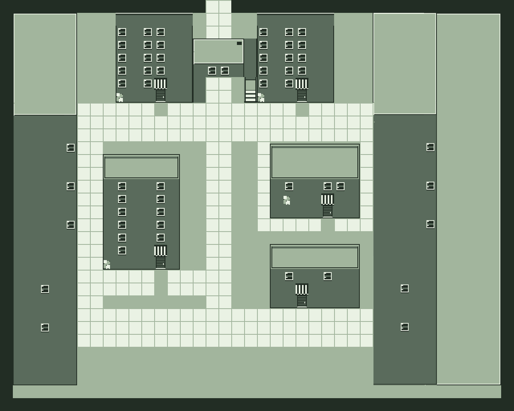
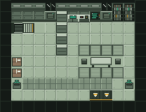

# Caleb Adu — Computer Science & Systems Engineering Portfolio

[](https://github.com/CalebNoADU/caleb-adu-portfolio/actions/workflows/ci.yml)
[](https://calebnoadu.github.io/caleb-adu-portfolio/)
[](https://calebnoadu.github.io/caleb-adu-portfolio/Caleb_Adu_CV.pdf)

MSc Computer Science student (Queen Mary University of London) with a background in Economics & Management (BA Hons, 2:1) and technical troubleshooting at Apple. I build across **embedded ARM7TDMI C**, **Python & SQL/Vector retrieval systems**, and **offline-first web applications & game engines**.

> **Live Interactive Portfolio Hub:** [calebnoadu.github.io/caleb-adu-portfolio](https://calebnoadu.github.io/caleb-adu-portfolio/) · **CV:** [Download CV (PDF)](Caleb_Adu_CV.pdf) *(redacted public edition)*

---

## Featured Projects

| Project | Domain | Tech Stack | Live / Code | Highlights |
| :--- | :--- | :--- | :--- | :--- |
| **[Project GMK — GBA Engine Systems](projects/project-gmk-gba-engine/)** | Embedded C / Game Dev | `C (C89/C17)` · `ARM7TDMI` · `devkitARM` · `4bpp Pixel Art` | [Source & Docs](projects/project-gmk-gba-engine/) | True permadeath with **Flash Sector 31** checksummed persistence, bounty enlistment UI state machine, ARM out-of-bounds crash postmortem, and 2.16s 12-core builds |
| **[OctoCrystal Sanctum](projects/octocrystal-sanctum/)** | Game Engine / Algorithms | `JavaScript (ES Modules)` · `HTML5 Canvas` · `Node.js Tests` | [Play Live](https://calebnoadu.github.io/caleb-adu-portfolio/projects/octocrystal-sanctum/) · [Code](projects/octocrystal-sanctum/) | Deterministic seeded HD-2D JRPG roguelike with BFS-verified procedural dungeons, shadowcasting FOV, Break & Boost combat, and automated verification suite |
| **[MySQL 26.x Native VECTOR & DualRAG Lab](projects/mysql-vector-rag-sandbox/)** | Databases / AI Retrieval | `MySQL 26.x` · `SQL` · `JSON` · `Bash` | [Source & SQL](projects/mysql-vector-rag-sandbox/) | Isolated local MySQL sandbox, deterministic `DISTANCE()` polyfill (`COSINE`/`L2`/`DOT`) for native `VECTOR(8)` columns, and pure-SQL Hybrid RAG payload builder |
| **[JoyBooks Semantic Search](projects/joybooks-semantic-search/)** | NLP / Information Retrieval | `Python` · `HTML/JS` | [Try Preview](https://calebnoadu.github.io/caleb-adu-portfolio/projects/joybooks-semantic-search/web/) · [Code](projects/joybooks-semantic-search/) | Sub-second semantic passage retrieval across 11,992 literary passages using L2-normalized 1,500-D IDF-weighted embeddings + interactive browser preview |
| **[NeuroHabit Daily Protocol PWA](projects/neurohabit-pwa/)** | Offline-First Web / PWA | `JavaScript` · `Service Worker` · `Web Manifest` | [Open App](https://calebnoadu.github.io/caleb-adu-portfolio/projects/neurohabit-pwa/) · [Code](projects/neurohabit-pwa/) | Installable offline PWA with dynamic day-of-week & multi-phase protocol engine, hydration tracker, and animated 5-min Cyclic Physiological Sigh timer |
| **[Pulse Habit Tracker](projects/pulse-habit-tracker/)** | Frontend UI | `JavaScript` · `SVG` · `HTML5 Canvas` | [Open App](https://calebnoadu.github.io/caleb-adu-portfolio/projects/pulse-habit-tracker/) · [Code](projects/pulse-habit-tracker/) | Lightweight habit & streak tracker with animated SVG completion ring, 14-day activity grid, and canvas confetti celebrations |
| **[Tic-Tac-Toe AI Suite](projects/tic-tac-toe-ai/)** | Algorithms / Full-Stack | `Python` · `FastAPI` · `Tkinter` · `JavaScript` | [Play vs. AI](https://calebnoadu.github.io/caleb-adu-portfolio/projects/tic-tac-toe-ai/web/) · [Code](projects/tic-tac-toe-ai/) | Unbeatable Minimax AI implemented across three interfaces: responsive dark-mode Web UI, FastAPI REST API, and Tkinter Desktop / CLI app |

---

## Creative & Systems Highlight: Project GMK (GBA ARM7TDMI)

Alongside software engineering coursework, I build low-level Game Boy Advance (ARM7TDMI) engine mechanics and custom brutalist `4bpp` pixel-art tilesets as part of my technical content creation projects:

| Early Concept Layout | Brutalist DMG Overworld Redesign | Interior Room (`208×160` / `4bpp`) |
| :---: | :---: | :---: |
|  |  |  |

- **Flash Sector 31 Persistence ([gmk_permadeath.c](projects/project-gmk-gba-engine/src/gmk_permadeath.c))**: Persists a magic-header (`0x474D4B31`), checksummed bitmask of unlocked operatives in GBA Flash Sector 31 while cleanly wiping campaign slots `0–29` on permadeath.
- **Hardware Crash Postmortem ([architecture-and-postmortem.md](projects/project-gmk-gba-engine/docs/architecture-and-postmortem.md))**: Diagnosed and resolved an ARM data abort caused by out-of-bounds indexing into `sAnimTable_Standard[20]` when NPC sprites triggered running animations.
- **Commercial Dev Tooling**: Built an accompanying *GBA Decomp AI Agent Kit* (static C89/C17 & charmap validator, `4bpp` indexed PNG converter, and parallel `devkitARM` build wrapper — kept in a separate private repo).

---

## Verification & Automated Checks

This repository includes a GitHub Actions CI pipeline ([.github/workflows/ci.yml](.github/workflows/ci.yml)) that verifies the roguelike engine invariants and Python syntax on every push:

```bash
# Run OctoCrystal Sanctum deterministic generation, BFS, FOV & combat tests
node projects/octocrystal-sanctum/tests/verify.mjs

# Validate Python modules
python3 -m py_compile \
  projects/joybooks-semantic-search/search_engine.py \
  projects/tic-tac-toe-ai/backend/main.py \
  projects/tic-tac-toe-ai/desktop/tic_tac_toe.py
```

---

## Technical Skills Snapshot

- **Languages**: Python, C (Embedded ARM7TDMI / C89 & C17), SQL (MySQL 9/26.x), JavaScript (ES Modules), HTML5 / CSS3, Bash / Zsh
- **Engineering Focus**: Procedural & game algorithms (Minimax, BFS, Shadowcasting FOV, deterministic PRNG), relational & vector database internals (`EXPLAIN`, B+Trees, `VECTOR` / DualRAG), offline-first PWAs, hardware-constrained C systems debugging, and data/statistical modeling
- **Note on Coursework & IP**: Active MSc graded assessment submissions, third-party textbooks/datasets, and copyrighted game ROMs are intentionally excluded from this public repository.
