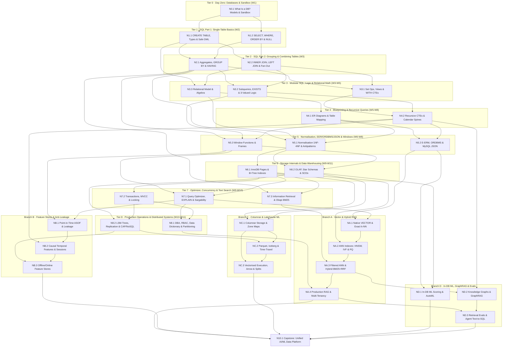

# Beginner-to-ML SQL & Database Mastery Skill Tree

> **Who This Is For:** Designed from **Day Zero for a complete beginner**, taking you gently step-by-step from *"What is a table?"* all the way to **InnoDB storage internals**, **Vector/Hybrid RAG databases**, **Anti-Leakage Feature Stores**, **Lakehouse storage**, and **In-DB ML / GraphRAG**.  
> **Core Trunk:** MySQL 8.x / 9.x (`./practice.sh` local 26.x Sandbox) & InnoDB Internals  
> **Hands-On Companion:** Paired with the runnable `./practice.sh` sandbox and progressive SQL exercises in `../sql/`.

---

## How a Beginner Should Use This Tree

1. **Start at `N0.1` — Never Skip Rungs:** Think of each node as a level in a game. Each node has a plain-English **Intuition ("Why This Matters")**, a **Study List** pointing to your exact `Resources/` slides and `Book refrences/` chapters, a **Mastery Gate Checklist**, **Silent Traps** beginners hit, and a **Boss Gate Challenge**. Only unlock child nodes once you pass the parent's Boss Gate!
2. **Start Small Before Big Datasets:** In Tiers 0–2, every Boss Gate begins on tiny 4–6 row classroom tables you can trace on paper (`mile_end_market` and `university_db` from Tutorials 1–6), then steps up to `lab_db` (`EMP`/`DEPT`), `dreamhome`, and `sakila` (~16k rentals).


---

## Dependency Graph (Strict Downward Progression)



---

## Complete Local Resource & Reference Map

| Local Folder / File | What It Teaches | Mapped Node(s) |
|---|---|---|
| `Resources/ecs740p_tutorial-01_intro-databases_2026-09-27.pdf` | Data vs DB vs DBMS, Three-Schema, Data Independence, CSV/JSON vs Models, Sandbox kickoff | `N0.1` |
| `Resources/SQL_1_gentle_flow.pdf` | Gentle intro: tables/schemas, `Student`/`Book` DDL, safe DML, `SELECT`/`WHERE`/`ORDER BY`/`NULL` | `N0.1`, `N1.1`, `N1.2` |
| `Resources/ecs740p_tutorial-02_sql-1_2026-10-06.pdf` | `mile_end_market` DDL constraints, query reading order, MySQL vs Oracle FreeSQL quirks, 5 safe lab rules | `N1.1`, `N1.2` |
| `Resources/SQL_2_Summarising and combining data.pdf` | Aggregates, `GROUP BY`, `HAVING`, `INNER`/`LEFT JOIN`, `UNION`/`INTERSECT`, `VIEW`, `WITH`, subqueries, `EXISTS`, 3VL, debug loop | `N2.1`, `N2.2`, `N3.1`, `N3.2` |
| `Resources/ecs740p_tutorial-03_sql-2_2026-10-14.pdf` | Step-by-step `GROUP BY` + `HAVING`, missing-row `LEFT JOIN`, correlated subquery on category average | `N2.1`, `N2.2`, `N3.2` |
| `Resources/Relational_Model_and_Relational_Algebra.pdf` | Relations vs bags, keys, $\sigma,\pi,\rho,\cup,\cap,-,\times,\bowtie,\div$, query trees & pushdown | `N3.3` |
| `Resources/ecs740p_tutorial-04_relational-algebra_2026-10-17.pdf` | `OFFER` keys, two RA notations, `SELLERS`/`BUYERS` sets, step-by-step Division $\div$ | `N3.3` |
| `Resources/er-Updated.pdf` & `Resources/er-mapping-Updated.pdf` | Entities, attributes, participation/cardinality, weak entities, 7 ER-to-table mapping rules (`I-L-L`) | `N4.1` |
| `Resources/ecs740p_tutorial-05_er-model_2026-10-28.pdf` | Mile End Market 8-sentence ER walkthrough (Chen & UML, `MEETUP_SPOT`, recursive `refers`) -> DDL | `N4.1` |
| `Resources/ecs740p_tutorial-06_normalisation_2026-11-11 (1).pdf` | `UNF` -> `1NF` -> 3 Anomalies -> FDs -> `2NF` -> `3NF` on `ITEM`/`CATEGORY`/`MODULE` | `N5.1` |
| `Resources/Extended-ER-Model-Updated (1).pdf` & `Extended-ER-Mapping-Updated (2).pdf` | E-ERM subclasses, Disjoint/Overlapping & Total/Partial, Shared Subclass (`TA`), Categories (`OWNER`) | `N5.2` |
| `Resources/ORDBMS_Updated.pdf` + `Lab work/04_Weeks_9-10_Advanced_DWH_IR_ORDBMS/exercise-ORDBMS.txt` | Oracle `OBJECT`, `VARRAY`, `NESTED TABLE`, `MEMBER FUNCTION`, ORDBMS vs pure RDBMS | `N5.2` |
| `Lab work/01_Weeks_2-5_SQL_Exercises/` (`exercise2`..`8`, `ex5`) | Core SQL functions, dates, joins, `GROUP BY`, subqueries, DML & advanced edge cases | `N1.1`–`N3.2` |
| `Lab work/02_Weeks_2-5_Relational_Algebra/` (`RA-exercises*.pdf`) | Relational Algebra practice (`Sailor`/`Boat`/`Reserve` division) | `N3.3` |
| `Lab work/03_Week_8_TODAY_Normalisation_and_DB_Design/` | `Normalisation_Exercises.txt` Parts A–E (1NF–4NF), anomalies, `Practice Quiz DB Design Feedback.pdf` | `N5.1`, `N5.2` |
| `Lab work/04_Weeks_9-10_Advanced_DWH_IR_ORDBMS/` | `exercise-IR.sql` (Okapi BM25), `dataWarehouseSQL.sql.txt` (`DOUGHNUT_SHOP`) + `DataWarehouseExercise.pdf` | `N6.2`, `N7.3` |
| `Book refrences/Database-System-A-Practical-Approach-to-Design-Implementation-and-Management-by-T-Connoly-C-Begg.pdf` | Full ECS740P textbook (`Ch. 10–14` strong on ER/Normalisation; watch `=`/`5` typo p.268 Ex 7.17/7.19) | `N0.1`–`N8.2` |
| `Book refrences/Database System Concepts (db-book.com)/Chapter-27..32.pdf` | Ch.27 Formal Query (TRC/Datalog), Ch.28 4NF/MVD, Ch.29 Objects, Ch.30 XML, Ch.31 IR, Ch.32 PostgreSQL | `N3.3`, `N5.1`, `N5.2`, `N7.3`, `N8.1`, `NA.2` |
| `Book refrences/Official MySQL Manuals/` (`8.4-LTS`, `9.0`, `AI-26.10`, `HeatWave`) | Native InnoDB/Optimizer docs + Ch.4 AutoML, Ch.5 Vector Store/RAG/`NL_SQL`, Ch.6 Performance | Trunk + `NA.1`–`NA.4`, `ND.1`, `ND.3` |
| `Book refrences/Open-Access Journals & Monographs/` | `FnT` Extensible Optimizers; `PVLDB-2026` Relational Lang Design & OmniTable; `IEEE DEBull 2025/2026`; `arXiv-2026` Text-to-SQL Evals; `SIGMOD Record` | `N3.2`, `N7.1`, `NC.2`, `NC.3`, `ND.3`, `N10.1` |

---

# PART I: BEGINNER CORE TRUNK (TIERS 0–8)

## Tier 0 — Day Zero: What Is a Database & Your First Sandbox (Week 1)

### `N0.1` Databases, Data Models, Architecture & Your First Sandbox
- **Prerequisites:** None *(Start Here!)*
- **Unlocks:** `N1.1`, `N1.2`
- **ECS740P / Study Guides:** Week 1 · `Resources/ecs740p_tutorial-01_intro-databases_2026-09-27.pdf` (24p) · `Resources/SQL_1_gentle_flow.pdf` (slides 1–8, 38–40) · Connolly & Begg Ch. 1–2
- **Workspace:** `./practice.sh` · `setup_practice_db.sql` (`mile_end_market`, `university_db`)
- **Beginner Intuition:** Before writing code, ask *why* apps don't just dump everything into one giant Excel or CSV file. In `Tutorial 1`, two QMUL students click "Buy" on the same desk lamp at once, or the server crashes mid-payment, or Alice renames herself while 50 listings show her old name. A **DBMS (like MySQL)** solves all four problems (concurrency, crash recovery, security/views, controlled redundancy) by separating **how data is structured** from the app itself.
- **Mastery Gate Checklist (Check All Before Moving On):**
  - [ ] Explain in plain English the difference between **Data** (facts), **Database** (related collection), **Schema** (the empty blueprint/column rules), **Instance** (the rows inside right now), and **DBMS** (software like MySQL that manages it).
  - [ ] Contrast a **data format** (`CSV`, `JSON`, `XML` — how text/bytes are written) vs. a **data model** (Relational tables, Document trees, Graph nodes/edges).
  - [ ] Sketch the **Three-Schema Architecture** (*External view $\to$ Conceptual table schema $\to$ Internal disk files/indexes*) and distinguish **Logical Data Independence** (changing tables without breaking user views) from **Physical Data Independence** (adding an index without rewriting app SQL).
  - [ ] Understand what SQL's **Data Dictionary / Catalogue** stores (table names, column types, constraints—not just user rows).
  - [ ] Start your local MySQL 26.7 sandbox (`./practice.sh start`) and run basic inspection commands without errors.
- **Key Commands / Mental Model:**
  ```sql
  -- Start locally in terminal: ./practice.sh start && ./practice.sh shell mile_end_market
  SHOW DATABASES;
  SHOW TABLES;
  DESCRIBE ITEM;
  SELECT * FROM ITEM;
  ```
- **Silent Traps:**
  - Thinking CSV is a "database model" (CSV has no typed constraints, multi-user locking, or crash recovery).
  - Mixing up **MySQL Server** (the database engine running on port `3307` / socket `/tmp/mysql_ecs740.sock`) with a **client tool** (terminal CLI, Workbench, or Python connector).
- **Boss Gate Challenge:** Boot `./practice.sh shell mile_end_market`, inspect every table with `DESCRIBE` and `SELECT *`, then answer `Tutorial 1` Practice 1 (slides 17–18: match the 4 Mile End Market bugs to DBMS features) and `Tutorial 1` slide 16 Quick Check (why adding an index to `ITEM` is *Physical* Data Independence).

---

## Tier 1 — SQL Part 1: Creating Tables & Reading Data Gently (Week 2)

### `N1.1` Building Tables & Safe Edits: `CREATE TABLE`, Types, Constraints & DML
- **Prerequisites:** `N0.1`
- **Unlocks:** `N2.1`, `N2.2`, `N3.3`
- **ECS740P / Study Guides:** Week 2 · `Resources/SQL_1_gentle_flow.pdf` (slides 9–21, 42–46, 58–61) · `Resources/ecs740p_tutorial-02_sql-1_2026-10-06.pdf` (slides 4–9, 23) · `MySQL-8.4-LTS-Reference-Manual.pdf` (Ch. 13 Data Types, Ch. 15 DDL/DML)
- **Workspace:** `setup_practice_db.sql` (`mile_end_market`, `university_db`) · `Lab work/01_Weeks_2-5_SQL_Exercises/exercise7.txt`
- **Beginner Intuition:** SQL has two jobs: **DDL** builds the empty shelves (`CREATE`, `ALTER`, `DROP`), and **DML** puts items on the shelves or changes them (`INSERT`, `UPDATE`, `DELETE`, `SELECT`). **Constraints** (`PRIMARY KEY`, `NOT NULL`, `CHECK`, `FOREIGN KEY`) act as automatic bouncers at the door—rejecting typos (negative prices, fake member IDs, duplicate IDs) *before* bad data enters your database.
- **Mastery Gate Checklist:**
  - [ ] Distinguish **DDL** (changes structure: `CREATE`/`ALTER`/`DROP`) vs. **DML** (changes/reads rows: `INSERT`/`UPDATE`/`DELETE`/`SELECT`).
  - [ ] Pick beginner-safe datatypes: `INTEGER` / `BIGINT` (whole IDs/counts), `VARCHAR(n)` (short variable text) vs. `CHAR(n)` (fixed padded codes), **`DECIMAL(p,s)` for money** instead of `FLOAT`/`DOUBLE` (avoids `0.1 + 0.2 != 0.3`), and `DATE` / `DATETIME` vs. UTC-converted `TIMESTAMP`.
  - [ ] Apply constraints consciously: `PRIMARY KEY` (unique + non-null identity per row), `NOT NULL`, `UNIQUE`, `CHECK` (enforced in MySQL 8.0.16+), and `FOREIGN KEY ... ON DELETE {RESTRICT | CASCADE | SET NULL}`.
  - [ ] Predict which `INSERT`/`UPDATE`/`DELETE` fails a constraint (`Tutorial 2` slides 6–9: e.g., deleting a parent `ITEM` still referenced by `SALE`!).
  - [ ] Practice `Tutorial 2`'s **Golden Safety Rule:** ALWAYS run `SELECT * FROM tbl WHERE ...;` *before* running `UPDATE` or `DELETE` with that exact `WHERE` clause, save `.sql` scripts cleanly, and never forget `sql_mode` strict validation.
- **Key Pattern:**
  ```sql
  CREATE TABLE ITEM (
    item_id     VARCHAR(5) PRIMARY KEY,
    title       VARCHAR(60) NOT NULL,
    seller_id   VARCHAR(5) NOT NULL,
    category_id VARCHAR(5) NULL,
    price       DECIMAL(6,2) NOT NULL CHECK (price >= 0),
    FOREIGN KEY (seller_id) REFERENCES MEMBER(member_id) ON DELETE RESTRICT
  );
  -- Always inspect BEFORE changing or deleting rows:
  SELECT * FROM ITEM WHERE item_id = 'I2';
  UPDATE ITEM SET price = 20.00 WHERE item_id = 'I2';
  ```
- **Silent Traps:**
  - Running `UPDATE Book SET price = 10.00;` **without a `WHERE` clause**—silently overwrites every book in the entire table!
  - Leaving an `ON DELETE CASCADE` on parent financial/audit records (deleting a member wipes out accounting history).
- **Boss Gate Challenge:** In `mile_end_market` (use a safe test transaction `START TRANSACTION; ... ROLLBACK;` so you keep seed data clean!), test 1 valid `INSERT` and 1 rejected `INSERT` (violating `CHECK (price >= 0)` or `FOREIGN KEY`), plus complete `Lab work/01_Weeks_2-5_SQL_Exercises/exercise7.txt` (`loans` table DDL/DML practice in a scratch database).

---

### `N1.2` Reading & Filtering Tables: `SELECT`, `WHERE`, `ORDER BY` & First `NULL` Rules
- **Prerequisites:** `N0.1`
- **Unlocks:** `N2.1`, `N2.2`
- **ECS740P / Study Guides:** Week 2 · `Resources/SQL_1_gentle_flow.pdf` (slides 22–37, 47–57) · `Resources/ecs740p_tutorial-02_sql-1_2026-10-06.pdf` (slides 10–29)
- **Workspace:** `mile_end_market`, `university_db.Book`, `Lab work/01_Weeks_2-5_SQL_Exercises/exercise2.txt` & `exercise3.txt`
- **Beginner Intuition:** Even though you *write* `SELECT ... FROM ... WHERE ... ORDER BY ... LIMIT`, SQL does **not** think in that order! Imagine a calm conveyor belt: **(1)** `FROM` grabs the table, **(2)** `WHERE` throws away rows that fail your test, **(3)** `SELECT` picks/computes the columns you want to display, **(4)** `DISTINCT` removes identical output rows, **(5)** `ORDER BY` sorts them, and **(6)** `LIMIT` slices the top `N`. Because `SELECT` runs *after* `WHERE`, a nickname (`AS with_fee`) created in `SELECT` doesn't exist yet inside `WHERE`!
- **Mastery Gate Checklist:**
  - [ ] Trace single-table **Logical Reading Order** by hand (`FROM` $\to$ `WHERE` $\to$ `SELECT` $\to$ `DISTINCT` $\to$ `ORDER BY` $\to$ `LIMIT`) to predict exact output before running SQL.
  - [ ] Explain why column aliases work in `ORDER BY` (`ORDER BY with_fee`) yet throw `Unknown column` inside `WHERE` (`Tutorial 2` Q4).
  - [ ] Write compound filters using `=`, `<>`, `<`, `<=`, `BETWEEN a AND b` (*inclusive!*), `IN (...)`, `LIKE '%pattern%'`, and parentheses around `OR` (`WHERE (job = 'CLERK' OR job = 'SALESMAN') AND sal > 1000`).
  - [ ] Handle **`NULL` correctly**: explain why `NULL` means *missing/unknown* (NOT `0`, NOT `''`, NOT `FALSE`), why `price = NULL` never matches anything, and why you must write `IS NULL` / `IS NOT NULL` or `COALESCE(col, 0)`.
  - [ ] Spot **MySQL 8 vs. Oracle FreeSQL** differences (`Tutorial 2` slide 21): `'single quotes'` for text (not `"double quotes"`), `''` stays empty text in MySQL (becomes `NULL` in Oracle), `FROM tbl AS alias`, case-insensitive string equality by default in MySQL (`'calculator' = 'Calculator'`), `NULL`s sort first in `ASC` in MySQL, and `LIMIT n`.
- **Key Pattern:**
  ```sql
  SELECT title, price
  FROM Book
  WHERE price IS NOT NULL
    AND (category = 'Science' OR price < 15.00)
  ORDER BY price DESC, title ASC
  LIMIT 5;
  ```
- **Silent Traps:**
  - Copying SQL directly from a slide PDF (`Tutorial 2` slide 23 warning!): PDFs turn `'quote'` into curly `’quote’` or drop hyphens cleanly—always type or copy from plain `.sql` files.
  - Filtering `WHERE price <> 15` expecting to see `'City Tales'` in `university_db.Book`—its `price` is `NULL`, so `NULL <> 15` is `UNKNOWN`, and `WHERE` drops it!
  - Putting `AND` and `OR` together without parentheses (`AND` binds tighter than `OR`!).
- **Boss Gate Challenge:** On `mile_end_market` and `university_db.Book`, predict on paper—then run—queries for `Tutorial 2` Lab Q5 (`LIKE`), Lab Q8 (`NULL` ordering in `ORDER BY`), and prove why `SELECT * FROM Book WHERE price < 15 OR price >= 15;` skips `'City Tales'` (missing 1 row!). Also practice date formatting (`exercise3.txt` using MySQL `DATE_FORMAT()`).

---

## Tier 2 — SQL Part 2: Summarising & Combining Multiple Tables (Week 3)

### `N2.1` Summarising Data: Aggregates, `GROUP BY`, `HAVING` & `WITH ROLLUP`
- **Prerequisites:** `N1.1`, `N1.2`
- **Unlocks:** `N3.1`, `N3.2`, `N5.1`, `N5.3`, `N7.3`
- **ECS740P / Study Guides:** Week 3 · `Resources/SQL_2_Summarising and combining data.pdf` (slides 1–20) · `Resources/ecs740p_tutorial-03_sql-2_2026-10-14.pdf` (slides 1–15)
- **Workspace:** `mile_end_market`, `lab_db.EMP`, `Lab work/01_Weeks_2-5_SQL_Exercises/SQL Exercise 5 (group-by).txt`, `exercise2.txt`, `sql/stage1_foundations_sakila.sql` (Ex 1.1, 1.3)
- **Beginner Intuition:** Instead of seeing 1,000 individual receipts, `GROUP BY` sorts rows into labelled buckets—say one bucket per `seller_id` or `deptno`—and shrinks each bucket down into **one summary row**. Remember the golden two-stage filter rule from `Tutorial 3`: **`WHERE` throws away unwanted individual rows *before* bucketing; `HAVING` throws away unwanted buckets *after* counting/averaging!**
- **Mastery Gate Checklist:**
  - [ ] Distinguish **`COUNT(*)`** (counts every row, including `NULL`s), **`COUNT(col)`** (counts only non-`NULL` values), **`COUNT(DISTINCT col)`**, and **`AVG(col)`** (divides by *non-`NULL`* count—NOT total rows!).
  - [ ] Trace **`GROUP BY` + `HAVING`** step-by-step on small tables: *every column in `SELECT` must either be in `GROUP BY`, wrapped in an aggregate (`COUNT`/`SUM`/`AVG`/`MIN`/`MAX`), or functionally determined by a `GROUP BY` primary key* (`ONLY_FULL_GROUP_BY`).
  - [ ] Choose **`WHERE`** (filters rows before grouping—faster & indexable!) vs. **`HAVING`** (filters whole groups on aggregate results like `COUNT(*) >= 2`).
  - [ ] Write **Conditional Aggregation (SQL Pivots)** using `SUM(CASE WHEN cond THEN 1 ELSE 0 END)` to count multiple categories side-by-side in one pass.
  - [ ] Add subtotals & grand totals with `GROUP BY a, b WITH ROLLUP` and use `GROUPING(a)` to tell real `NULL` data apart from summary `Total` rows.
- **Key Pattern:**
  ```sql
  SELECT seller_id, COUNT(*) AS n_items, ROUND(AVG(price), 2) AS avg_price
  FROM ITEM
  WHERE price >= 10                 -- 1) filter individual items FIRST
  GROUP BY seller_id                -- 2) form one bucket per seller
  HAVING COUNT(*) >= 2              -- 3) keep sellers with >= 2 items
  ORDER BY avg_price DESC;
  ```
- **Silent Traps:**
  - Running `AVG(comm)` on `lab_db.EMP` expecting the company-wide average commission: `AVG(comm)` skips `NULL`s (`550.00`), whereas company-wide with `0` for non-earners is `AVG(COALESCE(comm, 0))` (`157.14`)! (`exercise2.txt` Q6!)
  - Writing `HAVING category_id = 'C1'` instead of `WHERE category_id = 'C1'` (forces grouping of categories you were going to throw away).
- **Boss Gate Challenge:** First solve `Tutorial 3` slides 13–14 on `mile_end_market.ITEM` (*categories with $\ge 2$ items under £20*); then solve `SQL Exercise 5 (group-by).txt` on `lab_db` and complete `stage1_foundations_sakila.sql` Ex 1.1 & Ex 1.3 (`WITH ROLLUP` + MPAA rating conditional pivot).

---

### `N2.2` Combining Tables: `INNER JOIN`, `LEFT JOIN`, Self-Joins & Fan-Out Traps
- **Prerequisites:** `N1.1`, `N1.2`
- **Unlocks:** `N3.1`, `N3.2`, `N3.3`
- **ECS740P / Study Guides:** Week 3 · `Resources/SQL_2_Summarising and combining data.pdf` (slides 21–33) · `Resources/ecs740p_tutorial-03_sql-2_2026-10-14.pdf` (slides 16–22)
- **Workspace:** `mile_end_market`, `lab_db` (`EMP`, `DEPT`, `SALGRADE`), `Lab work/01_Weeks_2-5_SQL_Exercises/exercise4.txt`, `stage1_foundations_sakila.sql` (Ex 1.2, 1.6)
- **Beginner Intuition:** A well-designed database keeps `MEMBER` names in one table and `SALE` receipts in another so renaming Alice only updates 1 row. **`JOIN` stitches them back together cleanly!** Think visually: **`INNER JOIN`** keeps *only matching pairs*; **`LEFT JOIN`** keeps *every single row from the left table* even if no partner exists on the right (filling the missing right columns with `NULL`)—which lets you spot *"who has never bought anything?"* by checking `WHERE right.id IS NULL`!
- **Mastery Gate Checklist:**
  - [ ] Write explicit ANSI joins (`FROM A INNER JOIN B ON A.id = B.a_id`) instead of risky old-style comma joins (`FROM A, B`) that accidentally explode into Cartesian products ($4 \times 3 = 12$ rows) if you forget a `WHERE` match!
  - [ ] Always use short table **aliases** (`MEMBER m JOIN SALE s`) and trace 3-table link joins (`Student -> Enrolment -> Module`).
  - [ ] Use **`LEFT JOIN ... WHERE right_pk IS NULL`** accurately to find non-matching rows (`Tutorial 3` slide 20: members who never bought anything).
  - [ ] Avoid the **Outer Join `WHERE` Trap**: putting a condition on the right-hand nullable table inside `WHERE` (instead of inside `ON ... AND ...`) deletes the `NULL`-padded rows and silently downgrades `LEFT JOIN` into `INNER JOIN`!
  - [ ] Write **Self-Joins** (`EMP e JOIN EMP mgr ON e.mgr = mgr.empno`) and **Non-Equi Joins** (`sal BETWEEN losal AND hisal`), and spot **Chasm / Fan-Out Traps** (never join two independent `1:N` child tables to the same parent before aggregating each first!).
- **Key Pattern:**
  ```sql
  -- Who has NEVER bought an item? (Anti-join via LEFT JOIN + IS NULL)
  SELECT m.member_id, m.name
  FROM MEMBER m
  LEFT JOIN SALE s ON m.member_id = s.buyer_id
  WHERE s.sale_id IS NULL;
  ```
- **Silent Traps:**
  - Using **`NATURAL JOIN`** in production—if anyone later adds a `created_at` or `name` column to both tables, your join condition silently changes behind your back!
  - Joining `customer -> rental -> payment` directly before calling `SUM(payment.amount)` and `COUNT(rental.rental_id)`: if a customer has 10 rentals and 10 payments, naive joining multiplies rows and corrupts totals!
- **Boss Gate Challenge:** On `mile_end_market`, list every member alongside their purchases (`0` if none via `LEFT JOIN` + `COUNT(s.sale_id)`—NOT `COUNT(*)`!). Next, solve `exercise4.txt` Q6 on `lab_db.EMP` (employees earning more than their manager), then beat `stage1` Ex 1.2 (`LEFT JOIN` missing Sci-Fi films) & Ex 1.6 (`customer` total spend vs total rentals with zero fan-out inflation).

---

## Tier 3 — Modular Queries, Logic & Relational Algebra (Weeks 3–5)

### `N3.1` Set Operations, Saved Views & Readable `WITH` CTE Pipelines
- **Prerequisites:** `N2.1`, `N2.2`
- **Unlocks:** `N4.2`
- **ECS740P / Study Guides:** Weeks 3–4 · `Resources/SQL_2_Summarising and combining data.pdf` (slides 34–48, 68–76) · `PVLDB-2026-Tutorial-Relational-Language-Design-AI-Era.pdf` (syntax vs meaning!)
- **Workspace:** `mile_end_market`, `university_db`, `sakila`
- **Beginner Intuition:** When a question has 2 or 3 steps (*"First compute each module's average; next find students above their module's average; finally join student names"*), cramming everything into one giant nested query hurts your brain. **`WITH` (Common Table Expressions)** lets you give each step a clear English name (`WITH ModuleAverages AS (...) SELECT ...`), like variables in Python! Meanwhile, **`UNION` / `INTERSECT` / `EXCEPT`** stack/compare two whole result tables vertically like Venn diagrams.
- **Mastery Gate Checklist:**
  - [ ] Explain **Set Operations** visually (`UNION` deduplicates via sort/hash; `UNION ALL` stacks fast without deduplicating; MySQL 8.0.31+ native `INTERSECT` keeps rows in *both*; `EXCEPT` subtracts right rows from left rows).
  - [ ] Enforce **Union-Compatibility**: both queries must have the same number of columns and compatible column types (names come from the first query).
  - [ ] Compare **`CREATE VIEW`** (saved named query stored permanently in schema—great for reusing business rules & hiding PII) vs. **`WITH` CTE** (temporary named query existing only for *this one SQL statement*).
  - [ ] Reconcile two query versions (`Query A` vs `Query B`) cleanly via **symmetric difference**: `(A EXCEPT B) UNION ALL (B EXCEPT A)`.
  - [ ] Adopt `SQL_2` slide 73's **5-Step Calm SQL Debugging Loop**: `1. FROM/JOIN -> 2. WHERE -> 3. GROUP BY -> 4. HAVING -> 5. SELECT/ORDER BY`, checking row counts at every stage!
- **Key Pattern:**
  ```sql
  WITH Sellers AS (SELECT seller_id AS id FROM ITEM),
       Buyers  AS (SELECT buyer_id  AS id FROM SALE)
  SELECT id FROM Sellers
  INTERSECT
  SELECT id FROM Buyers;
  ```
- **Silent Traps:**
  - Putting `ORDER BY` inside a branch of `UNION` without parentheses: `(SELECT ... ORDER BY ... LIMIT 3) UNION ALL (SELECT ... ORDER BY ... LIMIT 3)`.
  - Confusing `INTERSECT` vs `UNION` precedence (`INTERSECT` evaluates tighter than `UNION`/`EXCEPT` unless parenthesized!).
- **Boss Gate Challenge:** In `mile_end_market`, use `INTERSECT` and `EXCEPT` to classify `MEMBER` into: (a) bought AND sold, (b) sold but never bought, and (c) neither bought nor sold—without any `JOIN`. Then solve `SQL_2` slides 69–72 on `university_db` (*students scoring above their module average, showing name, module title, mark, and module average*) using two chained `WITH` CTEs.

---

### `N3.2` Subqueries, `EXISTS` & Three-Valued Logic (`3VL`)
- **Prerequisites:** `N2.1`, `N2.2`
- **Unlocks:** `N4.2`, `N5.3`
- **ECS740P / Study Guides:** Weeks 3–4 · `Resources/SQL_2_Summarising and combining data.pdf` (slides 49–67) · `Resources/ecs740p_tutorial-03_sql-2_2026-10-14.pdf` (slides 23–37)
- **Workspace:** `mile_end_market`, `lab_db.EMP`, `dreamhome.PropertyForRent`, `Lab work/01_Weeks_2-5_SQL_Exercises/exercise6.txt`, `exercise8.txt`, `stage2` (Ex 2.3)
- **Beginner Intuition:** Sometimes you need to answer a mini-question inside a filter: *"Which items cost more than the average price?"* (`WHERE price > (SELECT AVG(price) ...)`). Beginners love `NOT IN (SELECT ...)`—**until one single `NULL` creeps into that inner list and makes the whole outer query return ZERO rows!** That happens because SQL uses **Three-Valued Logic** (`TRUE`, `FALSE`, `UNKNOWN`): `5 <> NULL` is `UNKNOWN`, and `WHERE` drops `UNKNOWN`. Learning **`EXISTS` / `NOT EXISTS`** makes your queries immune to `NULL` traps forever!
- **Mastery Gate Checklist:**
  - [ ] Write **Scalar** (`> AVG`), **List** (`IN`), **Derived-Table** (`FROM (SELECT ...)`), **HAVING**, and **Correlated** subqueries (`Tutorial 3` Lab Q7: comparing each item's price against the average of *its own* category).
  - [ ] Memorize **3-Valued Logic (3VL)** truth tables (`TRUE OR UNKNOWN = TRUE`; `FALSE AND UNKNOWN = FALSE`; `NOT UNKNOWN = UNKNOWN`) and explain why `WHERE`/`HAVING` reject `UNKNOWN` while `CHECK` permits `UNKNOWN`.
  - [ ] Prove why `x NOT IN (1, 2, NULL)` becomes `(x <> 1) AND (x <> 2) AND UNKNOWN` = `FALSE` or `UNKNOWN` for every `x` (always empty!).
  - [ ] Prefer **`EXISTS` / `NOT EXISTS`** (returns strict `TRUE`/`FALSE`, ignores `NULL`s, short-circuits on first match) and compare `> ANY` / `> ALL` accurately.
  - [ ] Memorize the **Full 8-Step Logical Processing Order**: `FROM/JOIN` $\to$ `WHERE` $\to$ `GROUP BY` $\to$ `HAVING` $\to$ `SELECT` (incl. Window Functions) $\to$ `DISTINCT` $\to$ `ORDER BY` $\to$ `LIMIT`.
- **Key Pattern:**
  ```sql
  -- SAFE anti-join (immune to NULLs in PropertyForRent.staffNo):
  SELECT s.staffNo, s.fName, s.lName
  FROM Staff s
  WHERE NOT EXISTS (
    SELECT 1 FROM PropertyForRent p WHERE p.staffNo = s.staffNo
  );
  ```
- **Silent Traps:**
  - `WHERE sal > (SELECT sal FROM EMP WHERE job = 'MANAGER')` crashes at runtime with `Subquery returns more than 1 row`! (Need `> ALL`, `> ANY`, `IN`, or `MAX()`).
  - Putting `EXISTS (SELECT col ...)` and thinking `SELECT NULL` makes `EXISTS` false—`EXISTS` ONLY checks whether *at least one row exists*, regardless of column values (`SELECT 1` is clearer).
- **Boss Gate Challenge:** First run `Tutorial 3` slides 31–36 on `mile_end_market.ITEM` (*items above their category average*); next solve `exercise6.txt` on `lab_db.EMP`; finally reproduce the `NOT IN (NULL)` silent bug on `dreamhome.PropertyForRent` (`stage2` Ex 2.3) and fix it using `NOT EXISTS`.

---

### `N3.3` Relational Model, Keys & Relational Algebra ($\sigma, \pi, \bowtie, \div$)
- **Prerequisites:** `N1.1`, `N2.2`
- **Unlocks:** `N4.1`, `N5.1`
- **ECS740P / Study Guides:** Weeks 4–5 · `Resources/Relational_Model_and_Relational_Algebra.pdf` (41p) · `Resources/ecs740p_tutorial-04_relational-algebra_2026-10-17.pdf` (38p) · `DB-System-Concepts-7e-Online-Chapter-27.pdf` (TRC/Datalog optional depth) · Connolly & Begg Ch. 4–5
- **Workspace:** `Lab work/02_Weeks_2-5_Relational_Algebra/` (`RA-exercises.pdf`, `RA-exercise2.pdf`) · `stage1` (Ex 1.4)
- **Beginner Intuition:** Now that you know how to *write* SQL, peek at the clean math behind it! **Relational Algebra** works like Lego blocks for tables: every operator takes 1 or 2 tables in and spits a clean duplicate-free **set table** out. Once you can read $\pi_{\text{name}}(\sigma_{\text{price} < 10}(\text{ITEM}))$ inside-out, you also see **why database optimisers love algebra**: swapping the order of $\sigma$ (filter rows early) and $\bowtie$ (join) gives the exact same answer **100× faster**!
- **Mastery Gate Checklist:**
  - [ ] Contrast **Pure Relational Sets** (unique rows, unordered) vs. **SQL Multisets/Bags** (`SELECT` keeps duplicates unless `DISTINCT` / $\pi$ is used).
  - [ ] Nail Key Theory (`Tutorial 4`): **Superkey** $\to$ **Candidate Key** (minimal superkey—removing any column breaks uniqueness!) $\to$ **Primary Key** $\to$ **Alternate Key** $\to$ **Foreign Key**; verify **Entity Integrity** (no PK column `NULL`) & **Referential Integrity**.
  - [ ] Trace all 8 operators visually (`Tutorial 4` & `Relational_Model_and_Relational_Algebra.pdf`): $\sigma$ (row filter), $\pi$ (column pick + deduplicate), $\rho$ (rename), $\cup / \cap / -$ (union-compatible), $\times$ (all pairs), $\bowtie = \sigma(\times)$ (join), and **Division $\div$ ("for ALL")**.
  - [ ] Draw **Query Trees** (leaves = tables, internal nodes = $\sigma, \pi, \bowtie$, root = result) and see why *Selection Pushdown* ($\sigma$ *before* $\bowtie$) shrinks intermediate work.
  - [ ] Translate Relational Division $R(A,B) \div S(B)$ ("related to every item in target set $S$") into both `GROUP BY ... HAVING COUNT(DISTINCT ...) = (SELECT COUNT(*) ...)` and the exact double-`NOT EXISTS` SQL idiom!
- **Key Translation:**
  ```text
  RA:  pi_title ( sigma_price<10 (ITEM) )    <-->  SQL: SELECT DISTINCT title FROM ITEM WHERE price < 10;
  RA:  R(A, B) ÷ S(B)   ("for all B in S")    <-->  SQL: SELECT ... WHERE NOT EXISTS (S WHERE NOT EXISTS (R))
  ```
- **Silent Traps:**
  - Mixing up $\sigma$ (*Select rows* = SQL `WHERE`) and $\pi$ (*Project columns* = SQL `SELECT DISTINCT`)!
  - Writing `HAVING COUNT(*) = N` for "all categories" without filtering to *only* target categories or using `DISTINCT` (renting the same Horror movie twice shouldn't count as 2 categories!).
- **Boss Gate Challenge:** Trace `Tutorial 4` slides 27–32 (`WANTED = {C1, C2}` division yielding Alice `M1`) and Lab Q1 (`OFFER` key `(member_id, item_id, made_at)`), solve `RA-exercise2.pdf` (*"sailors who reserved ALL red boats"*), and run `stage1` Ex 1.4 extended in `sakila` (*customers who rented at least one film in every category* via both `COUNT(DISTINCT)` and double-`NOT EXISTS`).

---

## Tier 4 — Blueprinting Schemas & Recursive Pipelines (Weeks 5–8)

### `N4.1` Conceptual Design: Entity-Relationship (ER) Diagrams & Mapping to Tables
- **Prerequisites:** `N3.3`
- **Unlocks:** `N5.1`, `N5.2`
- **ECS740P / Study Guides:** Weeks 5–6 · `Resources/er-Updated.pdf` (30p) · `Resources/er-mapping-Updated.pdf` (13p) · `Resources/ecs740p_tutorial-05_er-model_2026-10-28.pdf` (43p) · Connolly & Begg Ch. 12, 16–17
- **Workspace:** `setup_practice_db.sql` · `datasets/dreamhome/dreamhome_setup.sql`
- **Beginner Intuition:** You wouldn't build a house by pouring concrete before drawing blueprints—and you shouldn't write `CREATE TABLE` before drawing an **ER Diagram**! In an ER diagram, you capture *what things exist in the real world* (Entities: `MEMBER`, `ITEM`, `CAMPUS`) and *how they relate* (`sells`, `belongs_to`, `moderates`) **without worrying about Foreign Keys yet**. Then, **7 mechanical mapping rules** convert every shape cleanly into SQL tables!
- **Mastery Gate Checklist:**
  - [ ] Distinguish the **4 DB Design Phases** (`er-Updated.pdf` slides 4–5): *Requirements $\to$ Conceptual Design (ER) $\to$ Logical Mapping (Tables) $\to$ Physical Design (Indexes/Types)*.
  - [ ] Classify attributes accurately (`Tutorial 5`): **Simple vs. Composite** (`name` $\to$ `first_name`, `last_name`), **Single vs. Multi-Valued** (`phone` double oval!), **Stored vs. Derived** (`days_listed` from `listed_at`), and **Key** (underlined).
  - [ ] Specify both **Cardinality** (`1:1`, `1:N`, `M:N`) and **Participation** (*Mandatory/Total* vs. *Optional/Partial*) cleanly in Chen and UML `(min..max)` notation, including **Recursive** relationships (`MEMBER` refers `MEMBER`) with role names and **Ternary** relationships (`I-L-L`).
  - [ ] Model **Weak Entities** (double rectangle + dashed partial key, e.g., `MEETUP_SPOT(spot_name)` depending on `CAMPUS`) whose key comes partly from an owner entity.
  - [ ] Apply all **7 ERM $\to$ RM Mapping Rules** (`er-mapping-Updated.pdf` + `Tutorial 5` slides 30–39): strong entity, weak entity, `1:1` (plus `UNIQUE` FK!), `1:N` (FK on N-side—check `NULL` vs `NOT NULL` from participation!), `M:N` (bridge table!), ternary, and multi-valued attribute (`MEMBER_PHONE` / `DEPARTMENT_LOCATIONS`).
- **Key Mapping Summary:**
  ```text
  Strong Entity        -> Table (split composite attrs into columns; NO FKs inside ER!)
  Weak Entity          -> Table with (Owner_PK + Partial_Key) PK + ON DELETE CASCADE FK
  1:1 Relationship     -> FK placed on mandatory side (+ UNIQUE constraint)
  1:N Relationship     -> FK placed on the N-side (NOT NULL if mandatory, NULL if optional)
  M:N / Ternary        -> New bridge table holding all participating PKs as FKs (+ relationship attrs)
  Multi-valued Attr    -> Separate child table (Owner_PK, Attr_Value)
  ```
- **Silent Traps:**
  - Drawing **Foreign Key columns inside a conceptual ER diagram** (`Tutorial 5` reminder: FKs are a *logical/relational* detail added during mapping, NOT conceptual ER!).
  - Giving a repeating `Viewing` / `Offer` bridge table only `(client_id, property_id)` as its PK when the same client can inspect or bid multiple times on different timestamps!
- **Boss Gate Challenge:** Read the 8-sentence Mile End Market spec in `Tutorial 5` (slides 6–7), trace every entity (`MEMBER`, `ITEM`, `CATEGORY`, `MODULE`, `CAMPUS`, `MEETUP_SPOT`) and relationship into `MySQL` `CREATE TABLE` DDL (`MEMBER_PHONE`, `ITEM_MODULE`, `CAMPUS.moderator_id NOT NULL UNIQUE`), AND map ternary `Inter-Library-Loan` (`er-mapping-Updated.pdf` slide 11) + `DreamHome` `Viewing`.

---

### `N4.2` Recursive CTEs (`WITH RECURSIVE`), Trees & Calendar Spines
- **Prerequisites:** `N3.1`, `N3.2`
- **Unlocks:** `N5.2`, `N5.3`, `NB.2`, `ND.2`
- **ECS740P / Study Guides:** Weeks 3 & 8 Bridge · `MySQL-8.4-LTS-Reference-Manual.pdf` (`WITH` Syntax & Recursive CTEs)
- **Workspace:** `lab_db.EMP` (`EMPNO`, `MGR`) · `stage2_schema_analytics_antipatterns.sql`
- **Beginner Intuition:** A normal `JOIN` only steps one fixed hop at a time (*employee $\to$ manager*). What if a category tree, org chart, or social referral chain is 2 levels deep in one branch and 8 levels deep in another? **`WITH RECURSIVE`** acts like a controlled loop in SQL: **(1) Anchor** picks the starting row(s) (`KING`), **(2) Recursive Step** joins the table onto the CTE's latest batch of found rows (`e.mgr = tree.empno`), and **(3) Stop Rule / Depth Limit** prevents an infinite loop! You can also count `1, 2, 3...` recursively to generate missing calendar dates!
- **Mastery Gate Checklist:**
  - [ ] Identify the three required parts of every `WITH RECURSIVE` query: **Anchor member** (no self-reference), **`UNION ALL`** (or `UNION` to stop graph duplicates), and **Recursive member** (joins back to CTE name with guaranteed termination).
  - [ ] Avoid the **MySQL Anchor-Width Truncation Gotcha**: wrap string columns in the anchor with `CAST(ename AS CHAR(300))` so recursive `CONCAT(...)` doesn't overflow a tiny column width inferred from row 1!
  - [ ] Generate **contiguous Date / Integer Spines** recursively (so missing zero-sale calendar days don't disappear from charts or moving averages!) within `@@cte_max_recursion_depth` (default `1000`).
  - [ ] Add explicit **Cycle Detection** (`depth < 20` or path string check `NOT FIND_IN_SET(id, path)`) whenever traversing graphs that might loop.
- **Key Pattern:**
  ```sql
  WITH RECURSIVE org AS (
    SELECT empno, ename, 0 AS lvl, CAST(ename AS CHAR(300)) AS chain
    FROM EMP WHERE mgr IS NULL
    UNION ALL
    SELECT e.empno, e.ename, o.lvl + 1, CONCAT(o.chain, ' > ', e.ename)
    FROM EMP e JOIN org o ON e.mgr = o.empno
  )
  SELECT * FROM org ORDER BY lvl, chain;
  ```
- **Silent Traps:**
  - Omitting `CAST(... AS CHAR(n))` in the anchor row (MySQL truncates or raises `Data too long for column` on iteration 2!).
  - Traversing cyclic graphs (`MEMBER.referred_by` or KG edges) with `UNION ALL` and no depth/visited guard (`Recursive query aborted after 1001 iterations`).
- **Boss Gate Challenge:** On `lab_db.EMP`, compute every employee's level (`0` = `KING`), full management path string, and total subordinate headcount underneath each manager; then generate a 30-day date spine `('2005-05-24'`..`'2005-06-22')` in `sakila` without reading any table.

---

## Tier 5 — Normalisation, EER / ORDBMS / JSON & Window Analytics (Weeks 6–8)

### `N5.1` Normalisation (`UNF` $\to$ `1NF` $\to$ `BCNF` $\to$ `4NF`) & SQL Antipatterns
- **Prerequisites:** `N2.1`, `N3.3`, `N4.1`
- **Unlocks:** `N6.1`, `N6.2`
- **ECS740P / Study Guides:** Weeks 6 & 8 · `Resources/ecs740p_tutorial-06_normalisation_2026-11-11 (1).pdf` (39p) · `DB-System-Concepts-7e-Online-Chapter-28.pdf` (Multivalued Dependencies & 4NF) · Connolly & Begg Ch. 14–15
- **Workspace:** `Lab work/03_Week_8_TODAY_Normalisation_and_DB_Design/Normalisation_Exercises.txt` (Parts A–E), `stage2_schema_analytics_antipatterns.sql` (Ex 2.1)
- **Beginner Intuition:** Suppose you start with one giant spreadsheet (`enrolment_bad` or `Tutorial 6`'s `ITEM+CATEGORY+MODULE` sheet). Changing `"Databases"` in one row creates conflicting titles (**Update Anomaly**); you can't add a new course until a student enrolls (**Insertion Anomaly**); deleting the last student wipes the course (**Deletion Anomaly**)! **Normalisation** is a simple 4-question sanity check (*"1 value per cell? $\to$ Whole key? $\to$ Nothing but the key? $\to$ Independent multi-lists separated?"*) that splits one sloppy sheet into bulletproof lossless tables.
- **Mastery Gate Checklist:**
  - [ ] Demonstrate real **Update, Insertion, and Deletion Anomalies** in MySQL (`Normalisation_Exercises.txt` Part A).
  - [ ] Write **Functional Dependencies ($X \to Y$)** (*"whenever two rows agree on $X$, they must agree on $Y$"*) and compute **Attribute Closure ($X^+$)** to prove Candidate Keys rather than guessing.
  - [ ] Apply every Normal Form systematically (`Tutorial 6` + `Ch. 28`):
    - **1NF:** Atomic cells only (no `'ECS519U, ECS640U'` comma lists $\to$ defeats *Jaywalking*).
    - **2NF:** *Depend on the WHOLE key*—no non-key column depends on only *part* of a composite candidate key (`(item_id, module_code) -> item.title` via `item_id` alone violates 2NF!).
    - **3NF:** *Nothing BUT the key*—no transitive chain $PK \to A \to B$ (`item_id -> category_id -> category_name`).
    - **BCNF:** For every non-trivial FD $X \to Y$, $X$ MUST be a **superkey** (catches rare overlapping-candidate-key edge cases missed by 3NF).
    - **4NF:** Eliminate independent **Multivalued Dependencies ($X \twoheadrightarrow Y \mid Z$)** (`Ch. 28` + Part E of lab: `course ->-> lecturer` & `course ->-> book` belong in two separate tables!).
  - [ ] Recognize infamous **SQL Antipatterns**: *Jaywalking* (CSV IDs in `VARCHAR`), *Entity-Attribute-Value (EAV)*, *Polymorphic FKs*, and know when **controlled denormalisation** (snapshotting `unit_price_at_sale` on an invoice!) is *required* correctness, not a bug.
- **Key Formula / Mnemonic:**
  ```text
  UNF -> 1NF: One value per cell (atomic)
  1NF -> 2NF: Depend on the WHOLE key (no partial dependency on composite PK)
  2NF -> 3NF: Nothing BUT the key (no transitive dependency between non-keys)
  3NF -> BCNF: Determinant X of every non-trivial FD must be a superkey ("so help me Codd")
  BCNF -> 4NF: Split independent M:N multi-valued facts (X ->-> Y | Z)
  ```
- **Silent Traps:**
  - Believing *"My table has an `id` Primary Key so it's already in 3NF!"*—false! If `order_id -> customer_id -> customer_city`, it still fails 3NF!
  - Updating live foreign-key `item.price` instead of copying `price_at_sale` into `SALE`—past historical receipts would rewrite themselves whenever prices rise!
- **Boss Gate Challenge:** Complete `Tutorial 6`'s `ITEM`/`CATEGORY`/`MODULE` decomposition + all Parts A–E of `Lab work/03_Week_8_TODAY_Normalisation_and_DB_Design/Normalisation_Exercises.txt` (`1NF -> 2NF -> 3NF -> 4NF`) in MySQL, AND refactor `stage2` Ex 2.1 (`jaywalking_film_tags`) into a 3NF `film_tag` schema.

---

### `N5.2` Extended ER (`E-ERM`), `ORDBMS` & Semi-Structured SQL (`JSON`, `JSON_TABLE`)
- **Prerequisites:** `N4.1`, `N4.2`
- **Unlocks:** `NA.1`, `ND.1`
- **ECS740P / Study Guides:** Weeks 8–9 · `Resources/Extended-ER-Model-Updated (1).pdf` (15p) · `Resources/Extended-ER-Mapping-Updated (2).pdf` (7p) · `Resources/ORDBMS_Updated.pdf` (37p) · `DB-System-Concepts` Ch. 29 (Objects) & Ch. 30 (XML)
- **Workspace:** `Lab work/03_Week_8_TODAY_Normalisation_and_DB_Design/Practice Quiz DB Design Feedback.pdf` · `Lab work/04_Weeks_9-10_Advanced_DWH_IR_ORDBMS/exercise-ORDBMS.txt` · `stage1` Ex 1.5 · `stage2` Ex 2.1 · `datasets/ai_vector_demo/ai_vector_setup.sql`
- **Beginner Intuition:** Standard ER works until one entity comes in *subtypes* (`EMPLOYEE` can be `SECRETARY`, `ENGINEER`, or `MANAGER`; a `TEACHING_ASSISTANT` is both `STAFF` and `STUDENT`) or needs nested flexible attributes (varying metadata tags per chunk). **E-ERM** models inheritance hierarchies cleanly; **ORDBMS** (`ORDBMS_Updated.pdf`) shows how Oracle tried storing objects/arrays directly in tables (`CREATE TYPE`, `NESTED TABLE`), why pure relational tables remained dominant, and how **modern MySQL 8+/9+ gives you the best of both worlds** via native binary `JSON`, `JSON_TABLE()`, Generated Column Indexes, Views, and Stored Functions!
- **Mastery Gate Checklist:**
  - [ ] Model **E-ERM Specialisation/Generalisation** (`Extended-ER-Model-Updated`): **Type Inheritance**, constraints (**Disjoint vs. Overlapping** $\times$ **Total vs. Partial**), **Shared Subclasses** (lattices like `TEACHING_ASSISTANT`), and **Union Types / Categories** (`OWNER` = `PERSON` $\cup$ `COMPANY`).
  - [ ] Choose among **EER-to-Relational Mapping Strategies** (`Resources/Extended-ER-Mapping-Updated (2).pdf` & Connolly & Begg Ch. 13, 17): multiple-relation superclass+subclasses (`SSN` shared PK-FK), total-disjoint subclasses-only (`Car`/`Truck`), single table + boolean flags (`M_flag`, `P_flag`), shared subclass (`TEACHING_ASSISTANT`), and surrogate keys for Categories (`OwnerID`, `OwnerType`).
  - [ ] Read **ORDBMS** features (`ORDBMS_Updated.pdf` & `Ch. 29`): `CREATE TYPE ... AS OBJECT`, `VARRAY`, `NESTED TABLE`, `MEMBER FUNCTION`, vs. standard RDBMS normalization trade-offs (`12-row join` vs. nested object).
  - [ ] Master **MySQL Native `JSON` & `JSON_TABLE()`**: `->` vs `->>` (`JSON_UNQUOTE`), `JSON_OBJECT`/`JSON_ARRAYAGG`, shredding JSON arrays into typed rows with `JSON_TABLE`, and **indexing JSON** cleanly via `GENERATED ALWAYS AS (...) VIRTUAL` indexes or Multi-Valued Indexes `MEMBER OF()`.
  - [ ] Author safe **Views**, **Stored Functions** (`DETERMINISTIC`, `READS SQL DATA`, `NO SQL`), **Stored Procedures**, and cautious Triggers.
- **Key Pattern:**
  ```sql
  -- Modern MySQL 8+/9+ equivalent of nested metadata without sacrificing index speed:
  ALTER TABLE knowledge_chunks
    ADD COLUMN difficulty_tier VARCHAR(20)
    GENERATED ALWAYS AS (metadata_json->>'$.difficulty') VIRTUAL,
    ADD INDEX idx_chunks_diff (difficulty_tier);
  ```
- **Silent Traps:**
  - Using EER subclasses-only mapping when participation is *Partial/Optional* (superclass rows belonging to zero subclasses get orphaned!).
  - Filtering on `WHERE metadata_json->>'$.topic' = 'rag'` directly without a generated-column index (parses JSON row-by-row on a full table scan!).
- **Boss Gate Challenge:** Implement `Lab work/04_Weeks_9-10_Advanced_DWH_IR_ORDBMS/exercise-ORDBMS.txt` (`Person` / `Employee` / `Student`) comparing multiple-relation vs single-relation mapping in MySQL (`Practice Quiz DB Design Feedback.pdf` patterns), then add an indexed `VIRTUAL` generated column (`metadata_json->>'$.difficulty'`) to `ai_vector_demo.knowledge_chunks` and prove via `EXPLAIN` it avoids a full scan!

---

### `N5.3` Window Functions & Frame Semantics (`OVER`, `ROWS` vs `RANGE`)
- **Prerequisites:** `N2.1`, `N3.2`, `N4.2`
- **Unlocks:** `N6.2`, `N7.1`, `NB.1`
- **ECS740P / Study Guides:** Stage 2 Analytics · `MySQL-8.4-LTS-Reference-Manual.pdf` (Window Functions & Frame Specification)
- **Workspace:** `sql/stage2_schema_analytics_antipatterns.sql` (Ex 2.2, 2.4, 2.5, 2.6) · `sakila`
- **Beginner Intuition:** `GROUP BY` collapses 10 student rows into 1 average row—you lose the individual students! **Window Functions (`OVER (...)`) keep every individual row intact** while letting each row "peek through a window" at its peers to compute running totals, top-3 per category (`DENSE_RANK`), day-over-day differences (`LAG`), or 7-day rolling averages!
- **Mastery Gate Checklist:**
  - [ ] Know where Window Functions run in Execution Order (**during `SELECT`**—so you *cannot* put `WHERE ROW_NUMBER() = 1`; wrap it in a `WITH` CTE first!).
  - [ ] Master `PARTITION BY` (like `GROUP BY` buckets, without collapsing rows!) and `ORDER BY` inside `OVER (...)`.
  - [ ] Spot the **Default Window Frame Trap**: when `ORDER BY` is present, SQL defaults to **`RANGE BETWEEN UNBOUNDED PRECEDING AND CURRENT ROW`**—which merges tie peers AND causes **`LAST_VALUE()`** to return the *current row* instead of the partition's true final value unless you extend to `UNBOUNDED FOLLOWING`!
  - [ ] Distinguish all 3 frame units: **`ROWS`** (exact physical row count), **`RANGE`** (logical value/time interval like `INTERVAL 2 DAY PRECEDING`), and **`GROUPS`** (peer ties).
  - [ ] Pick between `ROW_NUMBER()` (unique 1,2,3), `RANK()` (ties leave gaps: 1,1,3), `DENSE_RANK()` (ties no gaps: 1,1,2), and compute deltas via `LAG`/`LEAD`.
- **Key Pattern:**
  ```sql
  SELECT customer_id, payment_date, amount,
         SUM(amount) OVER (
           PARTITION BY customer_id
           ORDER BY payment_date
           ROWS BETWEEN UNBOUNDED PRECEDING AND CURRENT ROW
         ) AS running_spend
  FROM payment;
  ```
- **Silent Traps:**
  - Using `ROWS BETWEEN 6 PRECEDING AND CURRENT ROW` for a "7-day rolling average" when days with zero sales are missing from the table (averages 7 *active* days, not 7 *calendar* days—pair with your `N4.2` calendar spine or `RANGE INTERVAL 6 DAY PRECEDING`!).
  - Using `LAST_VALUE(x) OVER (PARTITION BY g ORDER BY dt)` without `ROWS BETWEEN UNBOUNDED PRECEDING AND UNBOUNDED FOLLOWING`.
- **Boss Gate Challenge:** Complete `stage2_schema_analytics_antipatterns.sql` Ex 2.2, 2.4, 2.5, and 2.6 in `sakila`, **plus** improve Ex 2.4 with an `N4.2` recursive calendar spine to prove how `ROWS` differs from `RANGE INTERVAL 2 DAY PRECEDING` on zero-payment dates.

---

## Tier 6 — InnoDB Storage Engine & Data Warehousing (Weeks 9–11)

### `N6.1` InnoDB Storage Layout, 16KB Pages, B+Trees & Clustered Indexes
- **Prerequisites:** `N5.1`
- **Unlocks:** `N7.1`, `N7.2`, `N7.3`, `NA.2`, `NC.1`
- **ECS740P / Study Guides:** Weeks 9–10 · `MySQL-8.4-LTS-Reference-Manual.pdf` (Ch. 17 InnoDB Architecture & Index Structures)
- **Workspace:** `sql/stage3_indexing_performance_internals.sql` (Ex 3.2, 3.4, 3.5) · `sakila`
- **Beginner Intuition:** Up to now, tables felt like instant Python lists in RAM. Inside MySQL's **InnoDB** engine, rows live on disk inside **16 KB Pages**, cached in memory via the **Buffer Pool**. Without an index, `WHERE email = '...'` flips through *every single page* ($O(N)$). A **B+Tree Index** acts like an alphabetically sorted book index at $O(\log N)$—except in MySQL, **the Primary Key B+Tree IS the table itself** (*Clustered Index*), while every secondary index stores `(indexed_cols + PK)`!
- **Mastery Gate Checklist:**
  - [ ] Explain InnoDB's memory & disk pieces simply: **16 KB Pages**, **Buffer Pool** (LRU cache with midpoint insertion so a giant scan doesn't evict hot OLTP pages!), **Change Buffer**, and **Doublewrite Buffer**.
  - [ ] Contrast **Clustered Index** (Primary Key B+Tree leaf pages contain the *entire row*) vs. **Secondary Index** (leaf pages hold *only* `(indexed_col, primary_key)`, forcing a second PK lookup unless satisfied by a **Covering Index** `Using index`).
  - [ ] Understand why **random UUIDv4 Primary Keys** fragment pages and kill Buffer Pool hit rates vs. sequential `BIGINT` or time-ordered **UUIDv7**.
  - [ ] Master the **Composite Index Left-Prefix Rule** (and **ESR**: **Equality $\to$ Sort $\to$ Range**): `INDEX(a, b, c)` accelerates `(a)`, `(a,b)`, `(a,b,c)`, and `a = 1 AND b > 5`, while optimization stops for columns *after* a range predicate!
  - [ ] Check index selectivity, histograms (`ANALYZE TABLE ... UPDATE HISTOGRAM`), Index Condition Pushdown (ICP), and prune redundant left-prefix indexes (`sys.schema_redundant_indexes`).
- **Key Mental Model:**
  ```text
  Secondary Index Leaf: (customer_id, rental_date) + [hidden PK: rental_id]
    -> Covered if query ONLY needs (customer_id, rental_date, rental_id) -> Extra: Using index!
    -> Otherwise: Bookmark Lookup into Clustered PK B+Tree to read remaining columns.
  ```
- **Silent Traps:**
  - Creating separate `INDEX(a)` and `INDEX(a, b)` (`INDEX(a)` is completely redundant overhead on every `INSERT`/`UPDATE`!).
  - Indexing low-cardinality boolean flags (`is_active`) alone—random I/O chasing >20% of a table is slower than a sequential scan!
- **Boss Gate Challenge:** Complete `stage3_indexing_performance_internals.sql` Ex 3.2, 3.4, and 3.5 on `sakila`, measure table data vs index KB via `INFORMATION_SCHEMA.TABLES`, and explain why `EXPLAIN` shows `Using index` when `SELECT rental_id, rental_date` uses `UNIQUE KEY (rental_date, inventory_id, customer_id)`!

---

### `N6.2` OLAP, Star/Snowflake Schemas & Slowly Changing Dimensions (SCDs)
- **Prerequisites:** `N5.1`, `N5.3`
- **Unlocks:** `N8.2`, `NC.1`, `ND.1`
- **ECS740P / Study Guides:** Week 11 · `Lab work/04_Weeks_9-10_Advanced_DWH_IR_ORDBMS/DataWarehouseExercise.pdf` · Connolly & Begg Ch. 31–33 (DWH Concepts, Design & OLAP)
- **Workspace:** `Lab work/04_Weeks_9-10_Advanced_DWH_IR_ORDBMS/dataWarehouseSQL.sql.txt` (`DOUGHNUT_SHOP` schema)
- **Beginner Intuition:** Everyday shopping apps (**OLTP**) are optimised to insert/update 1 order at a time accurately using 3NF (`N5.1`). Analytics dashboards (**OLAP**) ask *"Total glazed-doughnut revenue across Q3 by city and customer gender?"* across millions of rows—joining 12 normalised tables slows down! So Data Warehouses reorganize history into a **Star Schema**: a central **Fact Table** of numeric measurements (`Sales`) surrounded by clean descriptive **Dimension Tables** (`Products`, `Branches`, `Buyers`, `Dim_Date`).
- **Mastery Gate Checklist:**
  - [ ] Contrast **OLTP** (3NF, small point lookups/writes, high concurrency) vs. **OLAP** (dimensional Star/Snowflake, bulk append, huge analytical scans).
  - [ ] Define **Fact Table Grain** (*"what exact real-world event does ONE row represent?"*) and separate **Additive** (`moneySpent`, `qty`), **Semi-Additive** (`accountBalance`—don't sum across dates!), and **Non-Additive** (`unitPrice`, ratios) metrics.
  - [ ] Implement **Slowly Changing Dimensions (SCD)**: **Type 1** (overwrite history), **Type 2** (`effective_from`, `effective_to`, `is_current` rows so historical reports remember a customer's old tier!), and **Type 3** (`prev_value` column).
  - [ ] Audit real dirty warehouse data (`DOUGHNUT_SHOP.Buyers.gender` stores literal string `'NULL'` instead of SQL `NULL`; `Sales.moneySpent` uses `DOUBLE PRECISION`).
- **Key Star Pattern:**
  ```text
  Fact_Sales(sale_sk, date_key [FK], branch_id [FK], product_id [FK], buyer_id [FK], qty, revenue_decimal)
  Dim_Buyer_SCD2(buyer_sk [PK], buyer_natural_id, city, tier, valid_from, valid_to, is_current)
  ```
- **Silent Traps:**
  - Mixing two grains (daily totals AND individual receipts) inside the same fact table (guarantees double-counting!).
  - Dividing totals without `NULLIF(SUM(denom), 0)` or averaging averages across mismatched group sizes.
- **Boss Gate Challenge:** Load `dataWarehouseSQL.sql.txt` (`DOUGHNUT_SHOP`) into your MySQL sandbox, convert `'NULL'` string defects in `Buyers` to real `NULL`, build a clean `Dim_Date` table from your `N4.2` calendar spine, and answer the queries in `DataWarehouseExercise.pdf` using `WITH ROLLUP` and Window functions.

---

## Tier 7 — Query Optimization, Concurrency & Text Search (Weeks 9–10)

### `N7.1` Query Optimizer, `EXPLAIN ANALYZE` & Sargable SQL
- **Prerequisites:** `N5.3`, `N6.1`
- **Unlocks:** `N8.1`, `NA.1`, `NB.1`
- **ECS740P / Study Guides:** Stage 3 Optimization · `MySQL-8.4-LTS-Reference-Manual.pdf` (Optimizing Queries & `EXPLAIN ANALYZE`) · `Book refrences/Open-Access Journals & Monographs/FnT-Monograph-Extensible-Query-Optimizers-in-Practice.pdf` (Cost models, Join/Group-By & Decorrelation rules!)
- **Workspace:** `sql/stage3_indexing_performance_internals.sql` (Ex 3.1, 3.2, 3.3)
- **Beginner Intuition:** SQL is *declarative*—you tell MySQL *what* you want, not *how* to fetch it. The **Query Optimizer** guesses how many rows each step will touch (using table statistics) and chooses whether to scan the whole table, walk a B+Tree, run a Nested Loop Join, or build a Hash Join. **`EXPLAIN ANALYZE`** actually runs the query with a stopwatch so you see where time went—and **Sargable SQL** avoids wrapping indexed columns in functions (`YEAR(dt) = 2006`) so the B+Tree isn't blinded!
- **Mastery Gate Checklist:**
  - [ ] Read `EXPLAIN`, `EXPLAIN FORMAT=TREE`, and **`EXPLAIN ANALYZE`** (compare *estimated `rows`* vs. *`actual rows`*, `actual time`, and **`loops`**—multiplies inner cost!).
  - [ ] Rank access types: `const`/`eq_ref` (best) $\to$ `ref` $\to$ `range` $\to$ `index` (*scans entire index!*) $\to$ `ALL` (*full table scan!*), and spot `Using filesort` / `Using temporary`.
  - [ ] Know when MySQL chooses **Nested Loop Join** (indexed inner lookup) vs. **Hash Join** (MySQL 8.0.18+ fallback for unindexed/large equi-joins).
  - [ ] Write strictly **Sargable** predicates (`dt >= '2006-01-01' AND dt < '2007-01-01'` instead of `YEAR(dt) = 2006`; `'abc%'` instead of `'%abc'`; matching column types—never `WHERE varchar_code = 12345`!).
  - [ ] Replace slow $O(N)$ **`OFFSET` pagination** (`LIMIT 20 OFFSET 15000`) with $O(\log N)$ **Keyset Seek Pagination** (`WHERE (rental_date, rental_id) > (...) ORDER BY rental_date, rental_id LIMIT 20`).
- **Key Transformation:**
  ```sql
  -- NON-SARGABLE (breaks index):  WHERE YEAR(rental_date) = 2006
  -- SARGABLE (uses B+Tree range): WHERE rental_date >= '2006-01-01' AND rental_date < '2007-01-01'
  ```
- **Silent Traps:**
  - Cheering when `EXPLAIN` shows `type: index`—that scans *every leaf page* of the index (only one step better than `ALL`!), whereas you want `range`, `ref`, `eq_ref`, or `const`.
  - Sorting large tables with `ORDER BY RAND() LIMIT 1` (scans & sorts the whole table).
- **Boss Gate Challenge:** Complete `stage3_indexing_performance_internals.sql` Ex 3.1 and Ex 3.3 on `sakila.rental`, comparing `EXPLAIN ANALYZE` execution times/row scans for `YEAR(rental_date)` vs. half-open range scan, and deep `OFFSET 15000` vs. tuple Keyset Seek pagination.

---

### `N7.2` Transactions, Locking, MVCC & Deadlock Handling
- **Prerequisites:** `N6.1`
- **Unlocks:** `N8.1`, `N8.2`
- **ECS740P / Study Guides:** Week 9 · Connolly & Begg Ch. 22 (Concurrency Control) · `MySQL-8.4-LTS-Reference-Manual.pdf` (InnoDB Locking & Transaction Model)
- **Workspace:** Two simultaneous `./practice.sh shell mile_end_market` sessions
- **Beginner Intuition:** Remember Tutorial 1 when *Bob and Carol clicked Buy on the same desk lamp at the exact same millisecond*? A **Transaction (`START TRANSACTION ... COMMIT / ROLLBACK`)** wraps multiple SQL steps into one **All-or-Nothing** unit. Under the hood, InnoDB lets readers see a consistent frozen photo of the database via **MVCC (Undo Logs + Read Views)** so readers don't block writers, while **Record, Gap, and Next-Key Locks** stop two writers from overwriting each other's money or lamp!
- **Mastery Gate Checklist:**
  - [ ] Trace **ACID** inside InnoDB: **A**tomicity (Undo Log rollback), **D**urability (Redo Log WAL + fsync), **I**solation (MVCC + Locks), **C**onsistency (valid constraint state).
  - [ ] Identify all 5 concurrency bugs: **Dirty Read**, **Non-Repeatable Read**, **Phantom Read**, **Lost Update** (read-then-write race!), and **Write Skew** (two transactions read overlapping rules and write disjoint rows).
  - [ ] Map MySQL's 4 isolation levels (`READ UNCOMMITTED`, `READ COMMITTED`, `REPEATABLE READ` default, `SERIALIZABLE`) and explain how **MVCC Snapshot Reads** differ from **Locking / Current Reads** (`SELECT ... FOR UPDATE`, `UPDATE`, `DELETE`).
  - [ ] Trace **Record Locks**, **Gap Locks**, and **Next-Key Locks** (`record + preceding gap`) preventing phantom rows in `REPEATABLE READ`.
  - [ ] Keep transactions tiny, order locks consistently to avoid **Deadlocks** (retry error `1213`), and use `FOR UPDATE SKIP LOCKED` / `NOWAIT` for queue workers.
- **Key Safe Update Pattern:**
  ```sql
  START TRANSACTION;
  -- Plain SELECT uses MVCC snapshot (NOT a lock!); use FOR UPDATE or atomic math:
  SELECT stock FROM ITEM WHERE item_id = 'I1' FOR UPDATE;
  UPDATE ITEM SET price = price - 1.00 WHERE item_id = 'I1';
  COMMIT;
  ```
- **Silent Traps:**
  - Assuming `REPEATABLE READ` stops **Lost Updates** when your app runs `SELECT bal ...`, computes `new = bal - 10` in Python, and runs `UPDATE ... SET bal = new`! Plain `SELECT` acquires NO lock!
  - Running an `UPDATE ... WHERE unindexed_col = ...` in `REPEATABLE READ`: InnoDB scans and **Next-Key locks the entire table**, freezing concurrent inserts/updates!
- **Boss Gate Challenge:** Open two `./practice.sh shell mile_end_market` terminals side-by-side. Reproduce cleanly: (1) an MVCC snapshot read vs. committed change, (2) a Lost Update vs. `SELECT ... FOR UPDATE`, and (3) a deliberate two-row circular deadlock inspected via `SHOW ENGINE INNODB STATUS\G`.

---

### `N7.3` Information Retrieval in Relational SQL: TF-IDF & Okapi BM25
- **Prerequisites:** `N2.1`, `N6.1`
- **Unlocks:** `NA.3`
- **ECS740P / Study Guides:** Weeks 9–10 · `Book refrences/Database System Concepts (db-book.com)/DB-System-Concepts-7e-Online-Chapter-31.pdf` (Information Retrieval & Document-Length TF)
- **Workspace:** `Lab work/04_Weeks_9-10_Advanced_DWH_IR_ORDBMS/exercise-IR.sql` & `IR-in-DB_improved_last.xlsx`
- **Beginner Intuition:** `LIKE '%database%'` only checks *yes or no*—it can't tell whether a 10-page paper mentions `"database"` 40 times or a tweet mentions it once by accident! Search engines (and modern **Hybrid RAG**!) use an **Inverted Index** (Word $\to$ Document list) scored by **Okapi BM25**: **(1)** rare words like `"Sargable"` matter more than common words like `"the"` (**IDF**), **(2)** repeating a word helps *up to a diminishing ceiling* ($k_1$ saturation), and **(3)** short focused docs beat bloated walls of text (length normalisation $b$).
- **Mastery Gate Checklist:**
  - [ ] Model a relational **Inverted Index** schema (`coll`, `document`, `term`, `qterm`, `termspace`) tracking document length $\text{dl}(d)$, $\text{avgdl}$, and document frequency $n(t)$.
  - [ ] Explain every knob in **Okapi BM25** vs. raw **TF-IDF**:
    - Rare-term weight **IDF**: $\log\frac{N - n(t) + 0.5}{n(t) + 0.5}$ (or odds form in `exercise-IR.sql`).
    - Length penalty $K_{\text{piv}}(d) = (1 - b) + b \cdot \frac{\text{dl}(d)}{\text{avgdl}}$ ($b \approx 0.75$).
    - Diminishing returns TF: $\text{tf}_{\text{BM25}} = \frac{\text{tf} \cdot (k_1 + 1)}{\text{tf} + k_1 \cdot K_{\text{piv}}}$ ($k_1 \in [1.2, 2.0]$).
  - [ ] Fix Oracle-to-MySQL dialect quirks in `exercise-IR.sql` (`NUMBER`, `log(10, ...)`, `qterm` line-97 `DocId` typo!) and compare custom SQL BM25 against MySQL native `FULLTEXT` indexes (`MATCH(...) AGAINST(...)`).
- **Key Formula:**
  $$\text{BM25}(d, q) = \sum_{t \in q} \text{IDF}(t) \cdot \frac{\text{tf}(t, d) \cdot (k_1 + 1)}{\text{tf}(t, d) + k_1 \cdot \left(1 - b + b \cdot \frac{\text{dl}(d)}{\text{avgdl}}\right)}$$
- **Silent Traps:**
  - Using naive `TF * IDF` without $k_1$ saturation lets keyword-stuffed spam pages top every search!
  - Leaving MySQL's default `innodb_ft_min_token_size = 3` untouched and wondering why `MATCH ... AGAINST ('AI' IN NATURAL LANGUAGE MODE)` ignores 2-letter keywords (`AI`, `ML`, `DB`)!
- **Boss Gate Challenge:** Cleanly port `exercise-IR.sql` into a runnable MySQL database (`ir_bm25_demo`), insert 8+ documents (including one long keyword-stuffed doc vs. one crisp focused doc), and confirm `score_BM25` outranks naive `TF * IDF` appropriately.

---

## Tier 8 — Production Operations & Distributed Systems (Weeks 10–11)

### `N8.1` Database Administration, RBAC, Data Dictionary & Partitioning
- **Prerequisites:** `N7.1`, `N7.2`
- **Unlocks:** `NA.4`
- **ECS740P / Study Guides:** Week 10 · `MySQL-8.4-LTS-Reference-Manual.pdf` (Partitioning, Roles, `sys`/`performance_schema`) · `DB-System-Concepts` Ch. 32 (PostgreSQL architecture comparison)
- **Workspace:** `sql/stage3_indexing_performance_internals.sql` (Ex 3.4, 3.5)
- **Beginner Intuition:** Running one database as `root` works on your laptop, never in production! **DBA fundamentals** give every service/analyst/AI agent *minimum permissions* (**RBAC**), read MySQL's built-in telemetry (`INFORMATION_SCHEMA`, `performance_schema`, `sys`) to catch slow queries before users complain, slice 100M-row tables cleanly into **Partitions** (so monthly drops take milliseconds instead of hours!), and take zero-lock online backups (`--single-transaction` + Binlog Point-in-Time Recovery).
- **Mastery Gate Checklist:**
  - [ ] Enforce **Least-Privilege RBAC**: `CREATE ROLE`, `GRANT`, separating OLTP writers from read-only analyst/Text-to-SQL AI accounts.
  - [ ] Inspect metadata & runtime telemetry via `INFORMATION_SCHEMA` (`TABLES`, `STATISTICS`, `KEY_COLUMN_USAGE`), `performance_schema` (`events_statements_summary_by_digest`), and `sys` (`schema_unused_indexes`, `innodb_lock_waits`).
  - [ ] Configure **Table Partitioning** (`RANGE` by date or `HASH`/`LIST` by `tenant_id`), prove **Partition Pruning** in `EXPLAIN`, and respect MySQL's rule that every unique/PK key *must include all partitioning columns*.
  - [ ] Understand **Online DDL** (`ALGORITHM=INSTANT/INPLACE, LOCK=NONE`) and Point-in-Time Recovery (`mysqldump --single-transaction` + `mysqlbinlog` / GTIDs).
- **Key Pattern:**
  ```sql
  CREATE TABLE rental_log (
    rental_id BIGINT NOT NULL, rental_year INT NOT NULL, customer_id INT NOT NULL,
    PRIMARY KEY (rental_id, rental_year)
  ) PARTITION BY RANGE (rental_year) (
    PARTITION p2025 VALUES LESS THAN (2026),
    PARTITION pmax  VALUES LESS THAN MAXVALUE
  );
  ```
- **Silent Traps:**
  - Partitioning a table by `created_at` when queries look up `WHERE user_id = ?` (scans EVERY partition—making reads slower than a normal table!).
  - Running `ALTER TABLE` in production without confirming `ALGORITHM=INSTANT`/`INPLACE` (triggers `COPY` lock outage!).
- **Boss Gate Challenge:** Query `sys` / `performance_schema` in your sandbox to report the top 5 digests by latency + any unused indexes (`stage3` Ex 3.5), then build a year/month `RANGE`-partitioned `rental_archive` table and verify partition pruning in `EXPLAIN`.

---

### `N8.2` Distributed Storage Engines: LSM-Trees, Replication, Sharding & CAP/NoSQL
- **Prerequisites:** `N6.2`, `N7.2`
- **Unlocks:** `NB.3`, `NC.2`
- **ECS740P / Study Guides:** Week 11 · Connolly & Begg Ch. 24–25 (Distributed DBMS) · Week 11 NoSQL Lecture
- **Workspace:** `datasets/ai_vector_demo/ai_vector_setup.sql` (DDIA chunk)
- **Beginner Intuition:** When one MySQL server gets too busy or too big for one disk, databases scale using **Replication** (copies for safety/reads) and **Sharding** (splitting rows across servers). Under the hood, write-heavy NoSQL engines (Cassandra, RocksDB) swap B-Trees for **LSM-Trees** (append fast to memory + flush immutable sorted files), while **CAP / PACELC** reminds you of a hard physics trade-off: when a network cable cuts between servers, you either risk stale reads (**Availability**) or pause writes (**Consistency**)!
- **Mastery Gate Checklist:**
  - [ ] Contrast **B+Trees** (fast point reads, in-place page updates) vs. **LSM-Trees** (append-only WAL + in-memory MemTable + sorted SSTables + background compaction—huge write throughput).
  - [ ] Compare **Single-Leader** (replication lag & *read-your-own-writes* anomaly!), **Multi-Leader** (write conflicts), and **Leaderless Quorums** ($W + R > N$).
  - [ ] Compare **Range Sharding** (range scans work, risk timestamp hotspotting) vs. **Hash / Consistent Hashing** (even spread, scatter-gather range queries).
  - [ ] Apply **CAP & PACELC Theorems** accurately and match the 4 **NoSQL families** (Key-Value, Document, Wide-Column, Graph) to workloads where relational MySQL isn't ideal.
- **Key Inequality:**
  ```text
  Quorum strict overlap: W + R > N  (ensures >= 1 replica holds latest write)
  PACELC: If Partition -> trade Availability vs Consistency; Else -> trade Latency vs Consistency
  ```
- **Silent Traps:**
  - Reading a user's just-updated profile from an async read replica right after `COMMIT`—replication lag hides their own edit!
  - Choosing `created_at` timestamp as a range-sharding key (100% of writes hammer the newest server!).
- **Boss Gate Challenge:** Write a 1-page Architecture Decision Record scaling `mile_end_market` to 50M users: state which tables remain InnoDB B+Trees, how checkouts avoid read-replica lag, what shard key prevents write hotspots, and which feature (e.g., feed cache or follow graph) fits NoSQL best.

---

# PART II: SPECIALIZED ML & AI DATABASE BRANCHES (TIERS 9–10)

---

## Branch A: Vector & Hybrid Retrieval Databases (RAG & Semantic Search)

### `NA.1` Native `VECTOR`, Distance Metrics & Exact k-NN in SQL
- **Prerequisites:** `N5.2`, `N7.1`
- **Unlocks:** `NA.2`
- **Study Guides:** `Book refrences/Official MySQL Manuals/MySQL-9.0-Reference-Manual.pdf` (`VECTOR` Type) · `MySQL-AI-User-Guide-26.10.pdf` (Ch. 5.7 Vector Embeddings)
- **Workspace:** `datasets/ai_vector_demo/ai_vector_setup.sql` · `sql/stage4_ai_vectors_rag.sql` (Ex 4.1, 4.2)
- **Beginner Intuition:** Keyword search (`N7.3`) knows `"car"` matches `"car"`, not `"automobile"`. AI embedding models turn text/images into a list of numbers (`VECTOR(d)`) where **nearby coordinates mean similar meaning**! In MySQL 9+/26.x, `VECTOR` is a native SQL column type, and `DISTANCE(u, v, metric)` ranks rows by geometric closeness. **Exact k-NN** compares every single row (100% accurate, great up to ~50k rows, too slow at 10M rows).
- **Mastery Gate Checklist:**
  - [ ] Store/inspect native vectors (`VECTOR(N)`, `STRING_TO_VECTOR`, `VECTOR_TO_STRING`, `VECTOR_DIM`) and compute raw memory ($4 \text{ bytes} \times d$ FP32: 1M $\times$ 1536-d $\approx 6.14\text{ GB}$ before index overhead!).
  - [ ] Choose and compute the 3 metrics: **Cosine Distance** ($1 - \frac{u \cdot v}{\|u\|\|v\|}$, angle-only), **Euclidean $L_2$** ($\sqrt{\sum (u_i - v_i)^2}$), and **Negative Dot Product** ($-(u \cdot v)$—identical order to Cosine/L2 iff vectors are unit-normalised $\|v\|=1$!).
  - [ ] Explain why exact $O(N \cdot d)$ k-NN needs `ORDER BY dist ASC LIMIT k` (or DESC for raw similarity) and fails latency budgets past ~50k–100k rows.
- **Key SQL:**
  ```sql
  SELECT chunk_id, DISTANCE(embedding, @query_vec, 'COSINE') AS dist
  FROM knowledge_chunks
  ORDER BY dist ASC
  LIMIT 5;
  ```
- **Silent Traps:**
  - Comparing un-normalised embeddings using `'DOT'` product (longer/higher-norm generic chunks unfairly win!).
  - Sorting Cosine *distance* `DESC` instead of `ASC` (returns the *least* relevant chunks!).
- **Boss Gate Challenge:** Complete `stage4_ai_vectors_rag.sql` Ex 4.1–4.2 in `ai_vector_demo`, then prove on unit-normalised `VECTOR(8)` rows that `COSINE` ASC, `EUCLIDIAN` ASC, and `DOT` give identical rankings.

---

### `NA.2` Approximate Nearest Neighbor (ANN): HNSW, IVF & Vector Quantisation
- **Prerequisites:** `NA.1`, `N6.1`
- **Unlocks:** `NA.3`
- **Study Guides:** `MySQL-AI-User-Guide-26.10.pdf` & `MySQL-HeatWave-Release-Notes.pdf` (`VECTOR INDEX USING HNSW`) · `DB-System-Concepts` Ch. 32 (`PostgreSQL` extension context for `pgvector`)
- **Engine Note:** Native HNSW indexes run in **MySQL HeatWave / Enterprise**; open-source apps use **`pgvector`**, **Qdrant**, **Milvus**, or **FAISS**—every ML engineer must understand the internals.
- **Beginner Intuition:** You cannot sort 50M vectors one-by-one in 10 ms (**Curse of Dimensionality** breaks B+Trees beyond ~10–20 dims!). **ANN Indexes** trade 1–5% recall for **100×–1000× speed**: **HNSW** builds multi-floor highway shortcuts over vector points (zoom across sparse express layers $\to$ walk local streets on floor 0), **IVF** groups vectors into cluster neighborhoods, and **Quantisation (SQ8 / Binary / PQ)** shrinks 60 GB of FP32 floats to fit inside RAM!
- **Mastery Gate Checklist:**
  - [ ] Explain why B+Trees & KD-Trees collapse to full scans in high dimensions (**Curse of Dimensionality**).
  - [ ] Tune **HNSW**: build-time `M` (links per node) & `ef_construction` vs. query-time `ef_search` (search beam width trading latency for `Recall@k`).
  - [ ] Contrast **HNSW** (fastest queries, high RAM, slower inserts) vs. **IVF-Flat** (`nlist` Voronoi clusters, scan `nprobe` cells, lower RAM).
  - [ ] Shrink RAM with **Quantisation**: **SQ8 / FP16** ($2–4\times$), **Binary 1-bit** ($32\times$ Hamming `XOR+POPCOUNT`), and **Product Quantisation (PQ)** (sub-vector codebooks + ADC) followed by **exact FP32 top-C re-ranking**!
- **Key RAM Formula:**
  $$\text{Raw FP32} = 4 \cdot d \cdot N \quad\vert\quad \text{HNSW RAM} \approx N \cdot (4d + 8 \cdot M) \text{ (often } 1.5\text{–}2\times\text{ raw)}$$
- **Silent Traps:**
  - Letting an HNSW graph spill onto disk—random graph-hop page faults destroy tail latency!
  - Deploying Quantisation/Binary vectors *without* oversampling top-$C$ ($C \approx 5k$) and re-ranking in full FP32.
- **Boss Gate Challenge:** Calculate RAM budgets (Raw FP32 vs. HNSW $M=16$ vs. SQ8 vs. PQ-64) for **10M $\times$ 1024-dim vectors**, and sketch a two-stage quantized candidate search (`LIMIT 50`) + exact FP32 re-rank (`LIMIT 10`) pipeline.

---

### `NA.3` Filtered Vector Search & Hybrid Retrieval (`BM25 + Dense RRF`)
- **Prerequisites:** `NA.2`, `N7.3`
- **Unlocks:** `NA.4`, `ND.2`
- **Workspace:** `stage4_ai_vectors_rag.sql` (Ex 4.3) · `exercise-IR.sql` · `ai_vector_demo`
- **Beginner Intuition:** Pure vector search hates exact product SKUs (`"ERR_1213"` or `"ECS740P"`) and struggles when users add filters (`"only tenant 42's 2026 PDFs"`). Meanwhile, **BM25 (`N7.3`)** nails exact keywords but misses synonyms! **Hybrid Search via Reciprocal Rank Fusion (RRF)** runs *both* retrievers and merges their rank positions cleanly with zero score-scaling headaches—while **single-stage/iterative filtered ANN** avoids the infamous *"0 results after post-filtering"* bug!
- **Mastery Gate Checklist:**
  - [ ] Diagnose the **Filtered ANN Dilemma**: *Post-filtering* (ANN top-20 $\to$ `WHERE tenant_id=42` $\to$ returns 0–1 rows!) vs. *Pre-filtering* (breaks HNSW graph connectivity) vs. **Inline bitmask traversal / iterative ANN scans / Partitioned indexes**.
  - [ ] Combine **Dense Vector (`NA.1`) + Sparse BM25 (`N7.3`)** cleanly via **Reciprocal Rank Fusion (RRF)** ($k_{\text{rrf}} = 60$):
    $$\text{RRF}(d) = \frac{1}{60 + \text{rank}_{\text{dense}}(d)} + \frac{1}{60 + \text{rank}_{\text{bm25}}(d)}$$
  - [ ] Merge retriever top-k lists with **`FULL OUTER` union semantics** (MySQL `LEFT JOIN UNION RIGHT JOIN` or union+`GROUP BY`) so docs ranking #1 in *only* BM25 aren't dropped by an `INNER JOIN`!
- **Key SQL RRF Pattern:**
  ```sql
  WITH combined AS (
    SELECT chunk_id, 1.0 / (60 + rn) AS rrf_part FROM dense_top10
    UNION ALL
    SELECT chunk_id, 1.0 / (60 + rn) AS rrf_part FROM bm25_top10
  )
  SELECT chunk_id, SUM(rrf_part) AS hybrid_score
  FROM combined GROUP BY chunk_id ORDER BY hybrid_score DESC LIMIT 5;
  ```
- **Silent Traps:**
  - Using `INNER JOIN` between top-k vector results and top-k BM25 results (kills every single-modal winner!).
  - Adding raw cosine `[0, 1]` directly to unbounded BM25 `[0, 45]` without rank fusion or min-max normalisation.
- **Boss Gate Challenge:** In `ai_vector_demo`, fuse `stage4` Ex 4.3 vector `COSINE` ranks with a `FULLTEXT` / BM25 (`N7.3`) ranking via RRF ($k=60$) inside a single SQL CTE query, proving unique keyword hits survive even when ranked low semantically.

---

### `NA.4` Production RAG Schemas, Chunking & Multi-Tenant ACL Isolation
- **Prerequisites:** `NA.3`, `N8.1`
- **Unlocks:** `ND.3`, `N10.1`
- **Study Guides:** `MySQL-AI-User-Guide-26.10.pdf` (Ch. 5.6–5.8 Ingesting Vector Stores & RAG) · `IEEE-Data-Engineering-Bulletin-2025-03-LLMs-Meets-Data.pdf`
- **Workspace:** `stage4_ai_vectors_rag.sql` (Ex 4.4) · `ai_vector_demo`
- **Beginner Intuition:** A real RAG database isn't one flat table of chunks! You separate **Documents** (title, URI, permissions/tenant), **Chunks** (`doc_id`, position, content hash so unchanged paragraphs aren't re-embedded on re-ingest, optional `parent_chunk_id` so small 200-token hits return rich 1000-token context!), and **Versioned Embeddings** (`model_id`, `VECTOR(d)`). Crucially, security ACLs (`WHERE tenant_id = ? AND acl_role IN (...)`) run **in SQL before `LIMIT`**—never ask an LLM prompt to "ignore secret docs"!
- **Mastery Gate Checklist:**
  - [ ] Normalize RAG storage cleanly: `documents` $\to$ `document_chunks` (`parent_chunk_id`, `token_count`, `SHA2(chunk_text, 256)` deduplication) $\to$ `chunk_embeddings` (`model_version`, `VECTOR(d)`).
  - [ ] Implement **Parent-Document (Small-to-Big) Retrieval** and **Token-Budget Windowing** (`SUM(token_count) OVER (ORDER BY score DESC) <= 1500`).
  - [ ] Enforce **Multi-Tenant / Role ACLs** strictly inside database partitions & predicates (`NA.3`), never post-`LIMIT`.
  - [ ] Emit structured citation JSON (`JSON_OBJECT` / `JSON_ARRAYAGG`) as done in `stage4` Ex 4.4.
- **Silent Traps:**
  - Re-embedding 10M chunks when 1 line of a PDF changes (always check `chunk_hash` first!).
  - Enforcing document permissions *after* `LIMIT 5` (user sees 0 results even though 5 allowed docs existed at rank #6–10!).
- **Boss Gate Challenge:** Extend `ai_vector_demo` with `documents`, `tenant_id`, `acl_role`, `token_count`, and `chunk_hash` (`UNIQUE`), then write an ACL-safe `stage4` Ex 4.4 RAG JSON packager capped at `<= 400` cumulative tokens using a window function.

---

## Branch B: Feature Stores & Anti-Leakage ML Data Engineering

### `NB.1` Point-in-Time Joins (`ASOF`) & Temporal Anti-Leakage
- **Prerequisites:** `N5.3`, `N7.1`
- **Unlocks:** `NB.2`
- **Beginner Intuition:** The #1 killer bug in tabular ML isn't neural-net math—it's **Data Leakage** (accidentally giving your training set answers from the *future*!). If you predict whether a `sakila` customer will return a rental late on **June 15**, joining their *"current total spend in August"* cheats! A **Point-in-Time (`ASOF` / `LATERAL`) Join** freezes the clock at each training row's `obs_ts` and fetches **only the latest feature snapshot strictly available before `obs_ts`** (`available_ts <= obs_ts`).
- **Mastery Gate Checklist:**
  - [ ] Define **Temporal / Bi-Temporal Leakage** (*event time* `feature_ts` vs. *ETL ingestion time* `available_ts` vs. *prediction time* `obs_ts` + stale **TTL** expiry).
  - [ ] Write leakage-free **Point-in-Time Joins** in 3 ways:
    - **MySQL 8.0.14+:** `LEFT JOIN LATERAL (SELECT ... FROM feat f WHERE f.eid = o.eid AND f.avail_ts <= o.obs_ts ORDER BY f.avail_ts DESC LIMIT 1) pit ON TRUE` (backed by `(eid, avail_ts)` composite index!).
    - **Portable SQL Window / Rank-1**.
    - **Analytical Engines (DuckDB / ClickHouse / Snowflake):** native `ASOF JOIN` ($O(N \log M)$ sorted merge).
- **Key MySQL Pattern:**
  ```sql
  SELECT r.rental_id, r.rental_date, p_pit.last_paid_amount
  FROM rental r
  LEFT JOIN LATERAL (
    SELECT p.amount AS last_paid_amount
    FROM payment p
    WHERE p.customer_id = r.customer_id AND p.payment_date < r.rental_date
    ORDER BY p.payment_date DESC LIMIT 1
  ) AS p_pit ON TRUE;
  ```
- **Silent Traps:**
  - Computing `SELECT customer_id, AVG(amount) FROM payment GROUP BY customer_id` and joining to historical training rows—100% future leakage!
  - Omitting a TTL bound (letting a 4-year-old stale profile feature represent today's active shopper).
- **Boss Gate Challenge:** On `sakila.rental` + `payment`, build a leakage-free training dataset attaching each rental's *exact prior payment amount* via `LEFT JOIN LATERAL`, and prove numerically why a naive `GROUP BY customer_id` join corrupts earlier rentals.

---

### `NB.2` Causal Temporal Features, Velocity Ratios & SQL Sessionisation
- **Prerequisites:** `NB.1`, `N4.2`
- **Unlocks:** `NB.3`
- **Workspace:** `sakila` (`rental`, `payment`) · `stage2` (Ex 2.4–2.6)
- **Beginner Intuition:** Static columns (*"city = London"*) are weak features; models love **behaviour over time** (*"how many rentals in the last 7 days vs. 90 days? How long since their previous visit? Is this a sudden midnight burst?"*). Using Window frames (`N5.3`), make every rolling feature **strictly causal** (`RANGE BETWEEN INTERVAL 30 DAY PRECEDING AND INTERVAL 1 SECOND PRECEDING`) so the current row *never* leaks into its own baseline, and solve **Gap-and-Island Sessionisation** (`> 30 min gap` = new session!) purely in SQL!
- **Mastery Gate Checklist:**
  - [ ] Exclude the current row strictly: `RANGE BETWEEN INTERVAL 30 DAY PRECEDING AND INTERVAL 1 SECOND PRECEDING`.
  - [ ] Compute **Velocity/Acceleration Ratios** (`spend_7d / NULLIF(spend_90d / 12.85, 0)`) and **Recency** (`TIMESTAMPDIFF(SECOND, LAG(ts) OVER (...), ts)`).
  - [ ] Implement **SQL Sessionisation**: flag boundaries `CASE WHEN gap > 30m THEN 1 ELSE 0 END`, then running `SUM(flag) OVER (...)` = `session_id`.
  - [ ] Compute **Safe Expanding Target Encoding** (prior historical late rate strictly before current `rental_date`—not full-table `AVG(label)`) and emit explicit `(value, is_missing)` flags so `NULL` ("never seen") isn't confused with `0.0`.
- **Boss Gate Challenge:** Write one causal SQL query on `sakila.rental` emitting per `rental_id`: `prior_rentals_7d`, `prior_rentals_30d`, `hours_since_prev_rental`, `session_id` (`gap > 24h`), and expanding `prior_spend_before_now`—zero future leakage!

---

### `NB.3` Feature Store Architecture: Offline / Online Parity & Serving
- **Prerequisites:** `NB.2`, `N8.2`
- **Unlocks:** `N10.1`
- **Beginner Intuition:** A model trained offline on 10M Parquet rows (`NB.1`/`NB.2`) goes to production and needs predictions in **< 10 ms**! If a data scientist writes rolling features in SQL for training and a backend engineer rewrites them in Python for production, tiny timezone/null bugs create **Training-Serving Skew** that quietly ruins accuracy. A **Feature Store** defines each feature *once* and syncs both an **Offline History Store** (for training/ASOF joins) and an **Online Low-Latency PK/Redis Store** (latest vector per entity for live inference).
- **Mastery Gate Checklist:**
  - [ ] Spot causes of **Training-Serving Skew** (UTC vs local timezone, `NULL`->`0` drift, inclusive vs exclusive time windows).
  - [ ] Architect the **Dual-Store Pattern**: append-only **Offline Store** (`(entity_id, ts)` time-series) paired with **Online KV/Clustered-PK Store** (1 latest row per `entity_id` for `< 5 ms` reads).
  - [ ] Connect MySQL **Binlog CDC** (Debezium/Kafka) + batch backfill to keep Online & Offline parity from a single SQL/YAML feature definition, plus feature versioning!
- **Boss Gate Challenge:** Prototype a Dual-Store mini Feature Store in MySQL: `customer_feature_history` (append-only `(customer_id, asof_ts)` for `NB.1` training) + `customer_feature_online` (Clustered PK `customer_id` updated atomically via `INSERT ... ON DUPLICATE KEY UPDATE`), demonstrating point-in-time export vs. `< 1 ms` PK lookup.

---

## Branch C: ML Data Formats, Lakehouses & Vectorised Execution

### `NC.1` Columnar Storage, Compression & Zone Maps
- **Prerequisites:** `N6.1`, `N6.2`
- **Unlocks:** `NC.2`, `NC.3`
- **Beginner Intuition:** InnoDB (`N6.1`) keeps all 25 columns of Row 1 together (**Row-Oriented**)—great for updating one order, wasteful when an ML job only reads 3 columns out of 200! **Columnar Storage** (Parquet, DuckDB, ClickHouse, BigQuery) packs Column 1 together, Column 2 together, etc.: it skips the 197 unread columns, compresses identical repeating values **5–20× smaller** (RLE, Dictionary, Delta), and checks **Min/Max Zone Maps** to skip entire megabyte blocks without even reading them!
- **Mastery Gate Checklist:**
  - [ ] Contrast **Row-Oriented (NSM)** (fast OLTP single-row read/write) vs. **Columnar (DSM)** (fast wide analytics & ML feature reads).
  - [ ] Explain why homogeneous columns compress far better than mixed rows (**Dictionary Encoding**, **Run-Length Encoding (RLE)**, **Delta/Bit-Packing**) and allow predicate evaluation on compressed IDs.
  - [ ] Trace **Zone Maps (Min-Max stats)** + **Bloom Filters**: why sorting rows by `(tenant_id, event_date)` unlocks 99% I/O skipping, while random UUID order skips 0%!
  - [ ] Explain **Late Materialisation** (filter bitmasks first, reconstruct surviving tuples last).
- **Silent Traps:**
  - Running single-row `UPDATE`/`DELETE` OLTP workloads on columnar files (rewrites huge immutable compressed chunks!).
  - Dumping unsorted Parquet files expecting Zone Map data skipping to work.
- **Boss Gate Challenge:** Compare InnoDB row size (`DATA_LENGTH`) vs. conceptual/exported columnar projection cost on a wide denormalised `DOUGHNUT_SHOP` / `sakila` feature table (`N6.2`), showing why sorting by `(store_id, payment_date)` maximizes Zone Map pruning.

---

### `NC.2` Open Lakehouse Table Formats (Parquet, Iceberg, Delta) & ML Time-Travel
- **Prerequisites:** `NC.1`, `N8.2`
- **Unlocks:** `NC.3`
- **Study Guides:** `Book refrences/Open-Access Journals & Monographs/PVLDB-2026-OmniTable-Petabyte-Scale-LLM-Data-Curation.pdf` (Iceberg/Delta vs feature-centric DAG curation for petabyte LLM data!) · `MySQL-HeatWave-Release-Notes.pdf` (Lakehouse support)
- **Beginner Intuition:** Just dumping raw `.parquet` files into an S3 bucket turns messy fast: no atomic transactions, crashed jobs leave half-written files, and tomorrow's overwrite breaks yesterday's ML training reproducibility! **Apache Iceberg / Delta Lake** wrap Parquet files in a tiny Git-like **Metadata Snapshot Layer** (`Snapshot -> Manifest List -> Manifests -> Parquet`), giving S3 ACID transactions, schema/partition evolution, and **ML Time-Travel (`VERSION AS OF snapshot_id`)** so you can *always* reproduce Model `v4.2`! Also read `PVLDB-2026-OmniTable` on how LLM data curation adds wide-column UDF DAGs on top of decoupled lakehouse storage!
- **Mastery Gate Checklist:**
  - [ ] Map **Parquet's** layout (*Row Groups $\to$ Column Chunks $\to$ Pages + Footer stats*) and explain the **Small Files Problem** (100k tiny files crush metadata/object-store latency).
  - [ ] Trace **Iceberg/Delta** ACID snapshots, optimistic concurrency, **Copy-on-Write (CoW)** vs. **Merge-on-Read (MoR)** deletes (GDPR!), and **Partition Evolution**.
  - [ ] Pin **exact Snapshot IDs** in ML experiment metadata tables (`model_runs.training_snapshot_id`) for reproducible time-travel (`FOR SYSTEM_TIME AS OF`).
- **Boss Gate Challenge:** Design an Iceberg ML dataset + governance spec for `DOUGHNUT_SHOP` (inspired by `PVLDB-2026-OmniTable` + Iceberg): specify sort/partition keys, CoW vs MoR trade-off for customer erasure, scheduled compaction, and an experiment-tracking table linking `model_version -> snapshot_id`.

---

### `NC.3` Vectorised Execution, Apache Arrow & Deterministic ML Splits
- **Prerequisites:** `NC.1`, `NC.2`
- **Unlocks:** `N10.1`
- **Study Guides:** `PVLDB-2026-OmniTable-Petabyte-Scale-LLM-Data-Curation.pdf` (decoupled CPU/GPU pipelines)
- **Beginner Intuition:** Classic SQL engines process **one row at a time** (slow function calls, CPU cache misses). Modern analytics/ML engines (DuckDB, Polars, DataFusion) process **2,048 values at once in contiguous arrays** (**Vectorised Execution + CPU SIMD**), and **Apache Arrow** lets them hand columnar arrays directly to NumPy / PyTorch with **Zero-Copy** (no slow row-by-row JSON/ODBC loops!). Equally vital: splitting Train/Val/Test cleanly in SQL using **deterministic hashing by `entity_id`**—never `ORDER BY RAND()`, which changes every run and splits the same user across Train and Test!
- **Mastery Gate Checklist:**
  - [ ] Contrast **Volcano (row-at-a-time)** vs. **Vectorised (batch SIMD)** vs. **JIT Compilation**.
  - [ ] Explain why **Apache Arrow** eliminates serialization bottlenecks between SQL/Lakehouses and Python/PyTorch/NumPy.
  - [ ] Write **Entity-Grouped Deterministic ML Splits** (`CRC32` / `MD5` hash bucket mod 100!) AND **Temporal Out-of-Time (OOT) Splits** cleanly in SQL without entity leakage!
  - [ ] Stream larger-than-RAM training sets via Arrow batches / Parquet row groups instead of `fetchall()`.
- **Key MySQL Split Pattern:**
  ```sql
  SELECT customer_id,
         CASE WHEN MOD(CONV(SUBSTR(MD5(customer_id), 1, 8), 16, 10), 100) < 70 THEN 'train'
              WHEN MOD(CONV(SUBSTR(MD5(customer_id), 1, 8), 16, 10), 100) < 85 THEN 'val'
              ELSE 'test' END AS split_bucket
  FROM customer;
  ```
- **Boss Gate Challenge:** Run a deterministic 70/15/15 `customer_id`-grouped split AND an out-of-time date split on `sakila.rental`, proving **0 overlapping customers** between `train` and `test` via `INTERSECT` (`N3.1`).

---

## Branch D: In-DB ML, GraphRAG & Retrieval Evaluation

### `ND.1` In-Database ML Scoring, AutoML & Vectorised Batch UDFs
- **Prerequisites:** `N5.2`, `N6.2`
- **Unlocks:** `N10.1`
- **Study Guides:** `Book refrences/Official MySQL Manuals/MySQL-AI-User-Guide-26.10.pdf` (Ch. 4 Training & Using Machine Learning Models / AutoML) · `MySQL-HeatWave-Release-Notes.pdf`
- **Beginner Intuition:** Instead of exporting 10 million rows to a Python notebook just to score a logistic regression, decision tree, or k-means cluster, **In-DB ML** brings the math *to the data* (`MySQL AI Ch. 4` `ML_TRAIN` / `ML_PREDICT_TABLE`, BigQuery ML, or pure-SQL weights!). Just beware calling a Python UDF **row-by-row** inside `WHERE`—always pass batches/Arrow vectors or pure SQL arithmetic!
- **Mastery Gate Checklist:**
  - [ ] Decide **In-DB Scoring** vs. **External GPU Python** cleanly using data gravity, latency, and governance criteria.
  - [ ] Express simple models directly in deterministic SQL: **Logistic Regression** ($1 / (1 + e^{-z})$), **Decision Trees** (`CASE WHEN`), and **Nearest Centroid** (`DISTANCE(vec, centroid, 'EUCLIDIAN')`).
  - [ ] Explore **MySQL AI / HeatWave AutoML (`MySQL-AI-User-Guide-26.10.pdf` Ch. 4)** workflow (`ML_TRAIN`, `ML_EXPLAIN`, `ML_PREDICT_TABLE`) vs. why row-by-row scalar UDFs bottleneck large tables (vs. vectorised Arrow batch UDFs).
  - [ ] Persist frozen feature normalization scalers (`mean`, `stddev`) inside `model_parameters` rather than computing them differently at inference time!
- **Boss Gate Challenge:** In `sakila`, store frozen logistic regression coefficients (`w_tx`, `w_spend`, `bias`) + Z-score scalers (`stage2` Ex 2.6) inside a `model_weights` table, and run one pure-SQL batch scoring query predicting `P(high_value = 1)` per customer.

---

### `ND.2` Knowledge Graphs, SQL/PGQ & GraphRAG Retrieval
- **Prerequisites:** `N4.2`, `NA.3`
- **Unlocks:** `ND.3`
- **Beginner Intuition:** Flat Vector RAG chops a textbook into isolated paragraphs—so it fails *multi-hop questions* (*"Which index helps Sargable queries avoid locks in MVCC?"* spanning 3 separate notes!). Storing entities & typed edges as a **Knowledge Graph** (`kg_entities`, `kg_edges`) lets you combine **Vector Entry Search (`NA.3`)** $\to$ **1–2 Hop Graph Expansion (`WITH RECURSIVE` / SQL:2023 `GRAPH_TABLE` / Cypher)** $\to$ richer connected context!
- **Mastery Gate Checklist:**
  - [ ] Contrast **Relational Index-Probed Multi-Hop Joins** (slows at 4+ hops) vs. **Native Graph Index-Free Adjacency** (Neo4j/FalkorDB direct pointers).
  - [ ] Read **SQL:2023 Property Graph Queries (SQL/PGQ)** (`CREATE PROPERTY GRAPH`, `GRAPH_TABLE ... MATCH (a)-[e]->{1,2}(b)`) and simulate bounded graph hops in MySQL using `kg_edges(src_id, rel_type, dst_id)` + `WITH RECURSIVE` (`N4.2`).
  - [ ] Explain why **GraphRAG** beats flat chunk RAG on multi-hop reasoning & dataset-wide global summaries.
- **Silent Traps:**
  - Traversing unbounded `*1..` paths across "super-nodes" (nodes with 100k edges!)—always bound depth (`depth <= 2`), filter edge types, and track visited nodes!
  - Creating duplicate uncanonicalized nodes (`"MySQL 8"`, `"MySQL8"`, `"InnoDB MySQL"`).
- **Boss Gate Challenge:** Add `kg_entities` and `kg_edges` to `ai_vector_demo` linking CS/DB concepts (`B-Tree -> Sargability -> Keyset Pagination -> MVCC`), seed entry nodes via `DISTANCE()`, and expand up to depth 2 cycle-free with `WITH RECURSIVE`.

---

### `ND.3` Retrieval Evaluation (`Recall@k`/`NDCG`), Embedding Drift & Agentic Text-to-SQL
- **Prerequisites:** `NA.4`, `ND.2`
- **Unlocks:** `N10.1`
- **Study Guides:** `MySQL-AI-User-Guide-26.10.pdf` (Ch. 5.10 `NL_SQL`, Ch. 6 Performance) · `arXiv-2026-Evaluation-Paradigm-Text-to-SQL-AI-Operators.pdf` · `PVLDB-2026-Tutorial-Relational-Language-Design-AI-Era.pdf` · `IEEE-Data-Engineering-Bulletin-2025-03` & `2026-03`
- **Workspace:** `ai_vector_demo` (`sample_search_queries`) · `stage4_ai_vectors_rag.sql`
- **Beginner Intuition:** Never ship RAG or an AI Text-to-SQL bot on "vibes"! Build a tiny ground-truth **Evaluation Table (`eval_qrels`)** right inside SQL to measure **Recall@k**, **MRR**, and **NDCG@k** mathematically across `COSINE` vs `BM25` vs `RRF`! Also read `arXiv-2026` on why rigid SQL exact-match evals break when SQL includes fuzzy AI filters (`AI.IF`), and harden **Agentic Text-to-SQL / MCP Tools** with read-only roles, timeouts, `LIMIT` caps, and `EXPLAIN` gates so an AI agent never drops your database or leaks PII!
- **Mastery Gate Checklist:**
  - [ ] Compute **Recall@k**, **MRR** ($\frac{1}{|Q|}\sum \frac{1}{\text{rank}_1}$), and **NDCG@k** ($\text{DCG}@k = \sum \frac{2^{\text{rel}_i} - 1}{\log_2(i+1)}$) in pure SQL over `eval_qrels(query_id, chunk_id, grade)`.
  - [ ] Plan **Zero-Downtime Embedding Model Upgrades** (shadow `embedding_v2` column/index + dual-write + atomic view swap).
  - [ ] Harden **Text-to-SQL / MCP Database Agents** (`N8.1`): strict read-only role, curated semantic Views (hide raw PII!), parameterized execution, `MAX_EXECUTION_TIME`, forced `LIMIT`, and `EXPLAIN` row-cost rejection gate—plus `arXiv-2026` stochastic evaluation awareness!
- **Boss Gate Challenge:** Add `eval_qrels` (grades `0–3`) for all 5 `sample_search_queries` in `ai_vector_demo` and write a pure-SQL eval report comparing `Recall@3`, `MRR`, and `NDCG@3` across `COSINE`, `EUCLIDIAN`, and Hybrid RRF!

---

## Tier 10 — Capstone Convergence

### `N10.1` Unified Multimodal & Hybrid AI/ML Data Platform
- **Prerequisites:** `NA.4`, `NB.3`, `NC.3`, `ND.1`, `ND.3`
- **Study Guides:** `Book refrences/Open-Access Journals & Monographs/IEEE-Data-Engineering-Bulletin-2026-03-AI-Native-Systems.pdf` (Agentic Data Environments & Data Clouds)
- **Beginner-to-Architect Synthesis Checklist:**
  - [ ] **OLTP Foundation:** Normalised 3NF/BCNF schema (`N5.1`), B+Tree covering indexes (`N6.1`), MVCC/locks (`N7.2`), `RANGE`-partitioned high-volume logs (`N8.1`).
  - [ ] **CDC & Reproducible Lakehouse:** Binlog CDC $\to$ Iceberg/Parquet snapshots (`N8.2`, `NC.2`) with snapshot-pinned Arrow training exports (`NC.3`).
  - [ ] **Anti-Leakage Feature Store:** `LATERAL`/`ASOF` PIT joins + strictly causal rolling windows (`NB.1`–`NB.2`) serving identical logic offline and `< 5 ms` online (`NB.3`).
  - [ ] **Hybrid RAG + GraphRAG + Evals:** HNSW/PQ + BM25 RRF (`NA.1`–`NA.3`), 2-hop Knowledge Graph expansion (`ND.2`), strict tenant ACLs (`NA.4`), SQL `NDCG@k` CI gates (`ND.3`), batch In-DB scoring (`ND.1`), and read-only `EXPLAIN`-gated Text-to-SQL agents!
- **Final Capstone Boss Challenge:** Design an end-to-end architecture doc + runnable MySQL prototype expanding `mile_end_market` into an AI marketplace: OLTP schema + leakage-free fraud features + deterministic `customer_id` Arrow training split + Hybrid semantic/BM25 product search + read-only agent analytics view.
