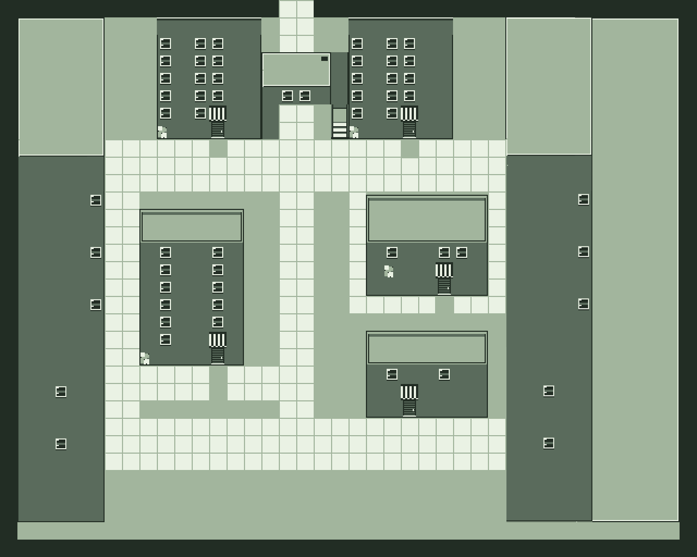
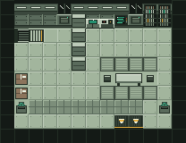
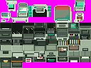

# Project GMK (*Good Morning Kanto*) — Embedded GBA ARM7TDMI C Engineering

Original C systems modules, hardware crash postmortems, build-pipeline optimizations, and custom brutalist `4bpp` pixel-art tilesets engineered for a roguelike Game Boy Advance (ARM7TDMI) total-conversion engine.

> **IP Notice**: Contains **100% original C source files, engineering docs, and custom artwork**. Zero Nintendo ROMs, base decompilation codebases, or copyrighted game assets are included.

## Visual Progression & Custom `4bpp` Art
| Brutalist Overworld Concept | Interior Room (`208×160`) | GBA `8×8` `4bpp` Hardware Tileset |
| :---: | :---: | :---: |
|  |  |  |

## Included Modules & Technical Writeups
- **[src/gmk_permadeath.c](src/gmk_permadeath.c) & [include/gmk_permadeath.h](include/gmk_permadeath.h)** — True roguelike permadeath implementation on GBA hardware:
  - Checksummed `GMKPersistentMeta` struct (`0x474D4B31` magic header + rolling checksum) stored in **Flash Save Sector 31** so unlocked operatives persist across full campaign save wipes (`slots 0–29`).
  - Dedicated `CB2` hardware state machine rendering the minimalist defeat screen before executing a clean GBA BIOS soft-reset (`DoSoftReset()`).
- **[src/gmk_bounty.c](src/gmk_bounty.c) & [include/gmk_bounty.h](include/gmk_bounty.h)** — Table-driven operative enlistment & tier-upgrade system with custom 16-color DMG palette, UI state machine, and overworld spawn suppression.
- **[docs/architecture-and-postmortem.md](docs/architecture-and-postmortem.md)** — Root-cause analysis of an ARM7TDMI out-of-bounds memory read (`sAnimTable_Standard[20]` → data abort) plus 12-core parallel `arm-none-eabi-gcc` optimizations cutting 32 MB ROM rebuild times to **~2.16s**.
- **[docs/tileset-redesign-study.md](docs/tileset-redesign-study.md)** — Deep dive into 9-slice terrain transitions, industrial architecture, and 4-shade DMG `8×8` `4bpp` tileset design.

> **Related Commercial Tooling**: Alongside Project GMK, I also developed a standalone *GBA Decomp AI Agent Kit* (static C89/C17 & charmap pre-flight validator, `4bpp` 16-color indexed sprite converter, and parallel `devkitARM` build automation) packaged as a separate developer-tooling product.
