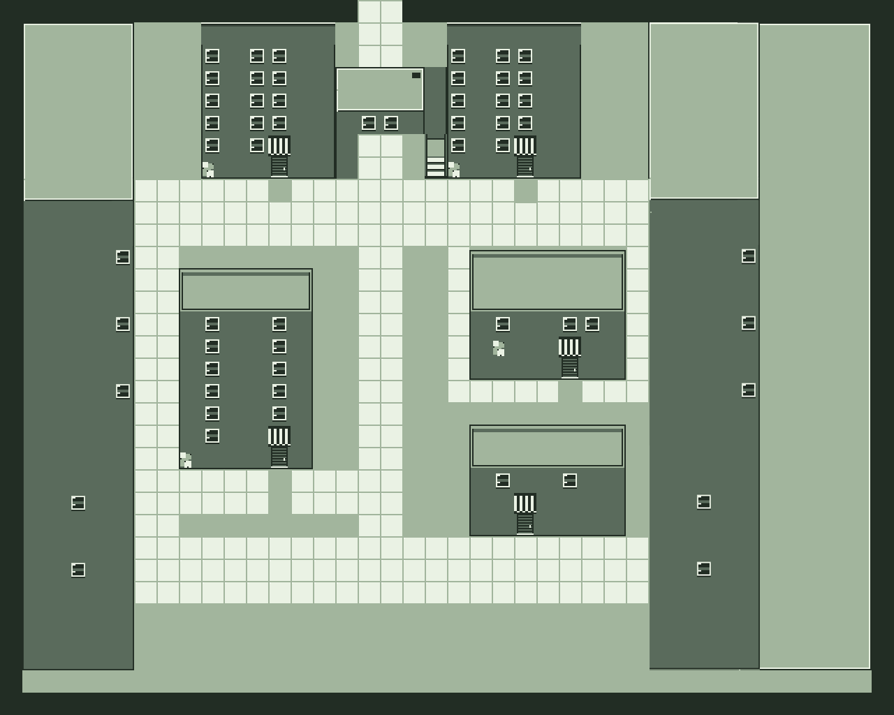
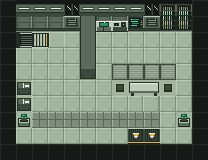

# Brutalist DMG Tileset & Overworld Redesign Study

A visual architecture and GBA `4bpp` tileset design study for **Project GMK**, engineered strictly within a **4-shade DMG/Industrial palette** (`#EAF2E4`, `#A2B59D`, `#5A6B5C`, `#222D24`) and 8×8 / 16×16 hardware metatile constraints.

---

## 1. Overworld Spatial Architecture & DMG Palette Study

### Key Design Principles
1. **9-Slice Terrain Transitions**: Using curbed sidewalks, cobblestone civic plaza paving, and crosswalk striping instead of flat uniform ground blocks.
2. **Multi-Section Industrial & Residential Roofs**:
   - Northern tenement blocks with tiled ridge slopes, rooftop HVAC units, vertical pilaster piers, deep-set dual-pane windows with 45° glass highlights, and striped awnings.
   - Industrial perimeter structures using corrugated steel decking, skylight monitors, exhaust fans, and concrete buttress walls.
3. **Contextual Clutter Vignettes**: Grouping props into functional zones (entrances, civic plazas, and logistics bays) within GBA metatile limits.

---

## 2. Interior Room & GBA 8×8 `4bpp` Indexed Tileset

All interior artwork was authored to fit GBA hardware limits (208×160 room layout compiled from an 8×8 `4bpp` 16-color indexed tileset):

| Interior Concept (`AREA 1 F1`) | Final Room Layout (`208×160`) | Raw Hardware Tileset (`128×96`, 4-bit Indexed) |
| :---: | :---: | :---: |
|  |  |  |
